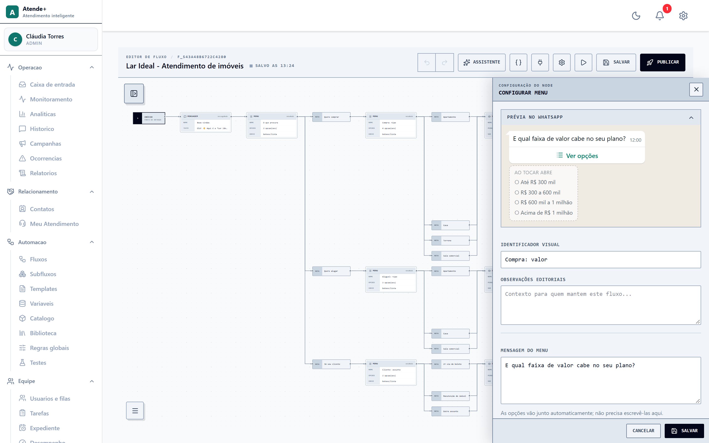
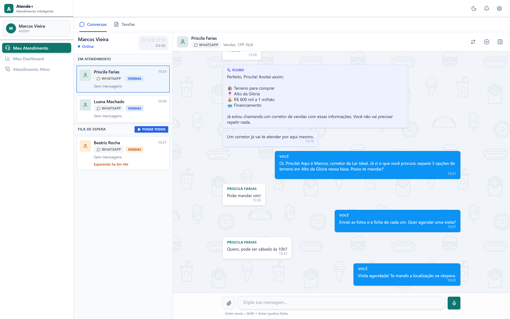
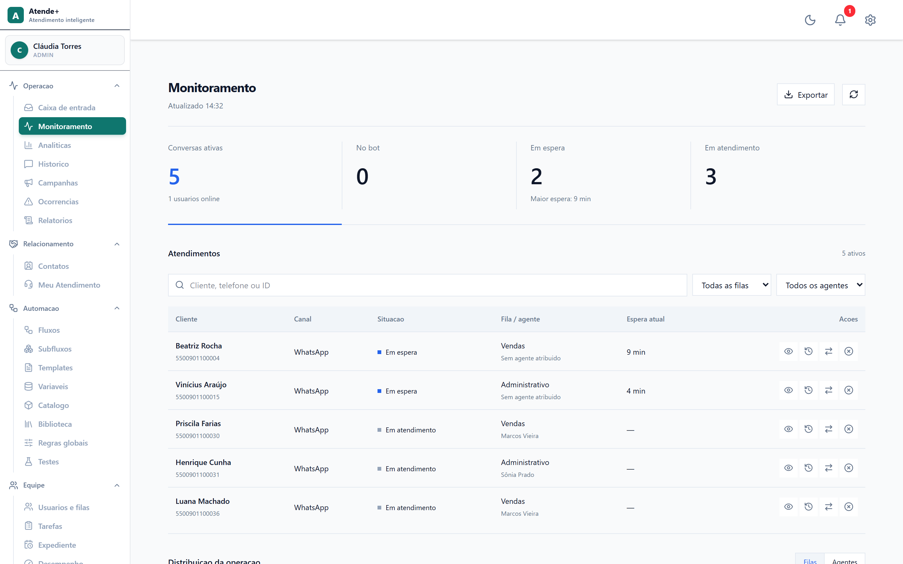
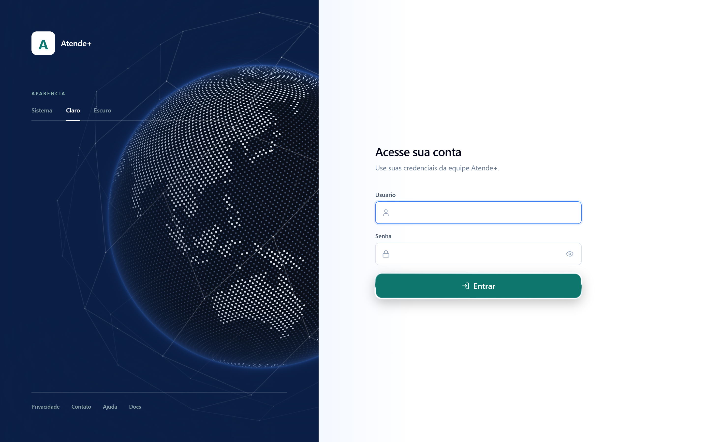

# Onion Flows

[English](README.md)

Plataforma de atendimento por WhatsApp para várias empresas ao mesmo tempo. Cada empresa monta o robô de atendimento num editor visual, passa a conversa para a equipe por filas e acompanha a operação ao vivo. Agências podem revender com a própria marca.

Feita e mantida por uma pessoa só. Roda em produção numa única máquina da Oracle Cloud, atrás de um Cloudflare Tunnel.



## O que faz

**Automação**
- Editor visual de fluxos (React Flow): mensagens, menus, perguntas com validação, condições, variáveis, chamadas de API, subfluxos, horários e âncoras.
- Assistente de IA no editor: descreva a mudança em português e confira os passos propostos antes de aplicar.
- Prévia de como cada menu chega no WhatsApp (botões ou lista).
- Simulador para testar o fluxo sem celular.

**Canais**
- WhatsApp Cloud API: conexão pelo Embedded Signup, mensagens interativas, templates, mídia, catálogo e pedidos, chamadas de voz.
- Telegram.
- Campanhas de disparo com trava de qualidade, pausa e histórico por contato.

**Atendimento humano**
- Filas por setor, regras de distribuição e horário de expediente.
- Caixa de entrada do atendente com o resumo deixado pelo robô, respostas prontas, transferência e tarefas.
- Nota de 1 a 5 no fim de cada atendimento, por atendente e por fila.

**Gestão**
- Monitoramento ao vivo: quem está esperando, há quanto tempo e com qual atendente.
- Analíticas, relatórios e histórico completo das conversas.
- Cargos e permissões por empresa.
- Ferramentas da LGPD: localizar e apagar os dados de um titular.

**Marca branca**
- Contas de parceiro (agência) que administram as próprias empresas.
- Logo, cores, nome do produto, ícone da aba, contato de suporte e imagem de login por agência.
- Endereço próprio da agência (`agencia.<seu-dominio>`), resolvido pela API.
- Cobrança do parceiro com fatura automática (Asaas) e pausa do serviço em caso de atraso, sem perder as mensagens que chegam.

| Caixa do atendente | Monitoramento |
|---|---|
|  |  |

| Analíticas | Login com a marca da agência |
|---|---|
|  |  |

## Arquitetura

```
WhatsApp / Telegram ──► webhook ──► fila Redis + BullMQ ──► motor de fluxos ──► Postgres
                                                  │
                             Socket.io ◄──────────┘
                                 │
                          Painel React (Vite)
```

- **API**: Node.js + Express, Socket.io para atualização ao vivo, Zod na validação, login por JWT com isolamento por empresa em toda consulta.
- **Banco**: uma camada de adaptadores (`db/`) sobre Postgres em produção e arquivo JSON no desenvolvimento local e nos testes.
- **Entrada do webhook**: Redis + BullMQ quando disponível, com caminho reserva direto para não perder mensagem se o Redis cair.
- **Painel**: React 19, Vite, Tailwind, React Flow, Recharts.
- **Operação**: script de publicação com checagem de saúde e volta de versão (`scripts/deploy.mjs`), painel estático servido pelo nginx, rastreio de erros no Sentry e rota de saúde dos recursos para alertas.

Mais detalhes em [docs/ARCHITECTURE.md](docs/ARCHITECTURE.md) e [API_DOCUMENTATION.md](API_DOCUMENTATION.md) (em inglês).

## Rodar na sua máquina

Precisa do Node.js 20.6 ou mais novo. O modo local usa banco JSON: não precisa de Postgres, Redis nem conta na Meta, e as mensagens de WhatsApp não saem de verdade.

```bash
npm install
npm --prefix client install
cp .env.sandbox.example .env.sandbox
npm run sandbox
```

Em outro terminal:

```bash
npm --prefix client run dev
```

Abra http://localhost:3000 e entre com `admin` / `sandbox123` (super admin) ou `agent` / `sandbox123` (atendente). Esses usuários só existem no banco JSON local.

Para instalar de verdade, copie `.env.example` para `.env` e `client/.env.example` para `client/.env` e preencha banco, WhatsApp e domínio.

## Testes

```bash
npm test
```

468 testes com o executor de testes do próprio Node, cobrindo motor de fluxos, mensagens do WhatsApp, distribuição, cobrança, permissões e isolamento entre empresas.

## Licença

[MIT](LICENSE)
