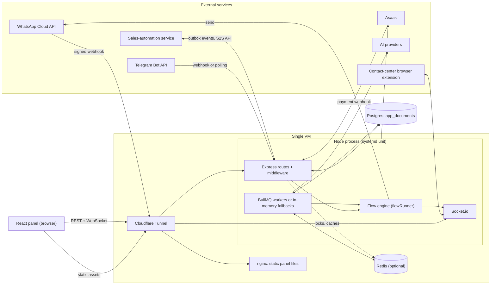
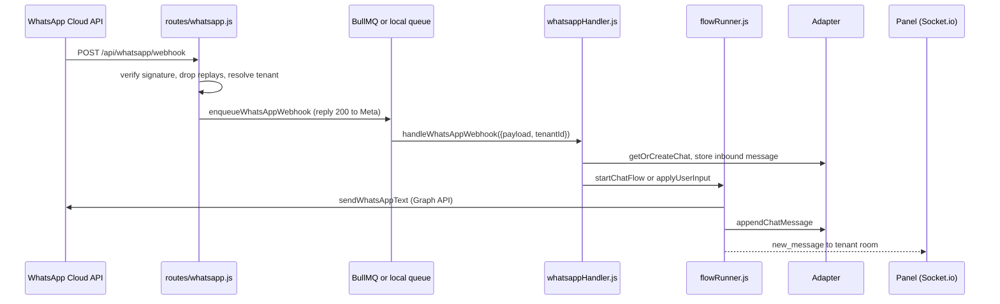

# Onion Flows: architecture

This document describes how the system is built today. It was written from the code, not from earlier design notes.

Route-level detail (every endpoint, who may call it) lives in [`API_DOCUMENTATION.md`](../API_DOCUMENTATION.md) and is not repeated here. Environment variables are documented in [`.env.example`](../.env.example), [`.env.sandbox.example`](../.env.sandbox.example) and [`client/.env.example`](../client/.env.example).

---

## 1. Overview

Onion Flows is a multi-tenant customer-service platform for WhatsApp (and Telegram). A tenant is a company. Each tenant builds chatbot flows in a visual editor, connects one or more WhatsApp numbers, and routes conversations to human agents through queues. Agencies ("partners") can resell the platform under their own brand and manage a portfolio of tenants.

What the code implements:

- Visual flow editor (React Flow) with draft/publish, history, rollback, a test simulator and an AI assistant that proposes edits; a flow engine that runs the published flow for each conversation.
- Human handoff: queues, pickup, transfer, close, and an optional return to the bot (for example to ask for a rating).
- Real-time monitor, analytics and CSV reports; LGPD data-subject tools and retention purging.
- Outbound campaigns and cadences, with rate limits, quality guards and AI classification of replies.
- WhatsApp Cloud API (Embedded Signup, interactive messages, templates, catalog and orders, voice calls) and Telegram.
- White label for partners (branding, agency subdomains, partner billing through Asaas) and billing pause: a blocked tenant still stores incoming messages, but the bot and all outbound sends stop.

### Runtime pieces

### Production topology

The repository's deploy scripts and nginx file describe this layout:

| Piece | How it runs |
|---|---|
| API | One Node process under systemd (service name `onion-flows`, see `scripts/deploy/remote-deploy.sh`). Releases live in `/opt/onion-flows/releases/<id>` and `/opt/onion-flows/current` is a symlink. |
| Panel | Static files built by Vite and served by nginx on `127.0.0.1:8080` (`scripts/deploy/nginx-painel.conf`). `deploy-frontend.sh` can also publish to Vercel with `--vercel`; `client/vercel.json` carries the matching cache rules. |
| Exposure | A Cloudflare Tunnel in front of nginx and the API. The API sets `trust proxy` to 1. |
| Database | Postgres through `db/PostgresAdapter.js` (a single `app_documents` table). |
| Redis and workers | Redis is optional. With `REDIS_ENABLED` and `BULLMQ_ENABLED` both on, webhooks and background jobs go through BullMQ, otherwise in-memory fallbacks are used (section 9). The BullMQ workers run inside the API process (`startBullMqWorkers`); there is no separate worker process. |

The design assumes one API process. Several caches, locks, rate limiters and the online-presence set are per process (details in section 16).

---

## 2. Repository layout

| Path | Contents |
|---|---|
| `index.js` | Bootstrap: env, adapter, Redis, workers, Express app, Socket.io, health routes, shutdown. |
| `db/DatabaseAdapter.js` | Adapter selection plus the JSON adapter (and the legacy Mongo and Supabase REST adapters). |
| `db/PostgresAdapter.js` | Postgres document adapter. |
| `src/config/` | `env.js` (loads `.env` with dotenv), `constants.js` (`JWT_SECRET_VALUE`, boot-time checks). |
| `src/middleware/` | `auth.js`, `authorization.js`, `tenant.js`, `superAdminIp.js`, `totpEnrollmentGate.js`, `rateLimits.js`, `correlationId.js`, `turizmoInboundAuth.js`. |
| `src/routes/` | One router per domain, re-exported by `src/routes/index.js`. |
| `src/services/` | Business logic and integrations (95 modules). The engine is `flowRunner.js`. |
| `src/queues/`, `src/workers/index.js` | BullMQ queue definitions with one producer file per queue, and the worker registration. |
| `src/schemas/index.js`, `src/utils/` | Zod request schemas; crypto, PII masking, TOTP, SSRF checks, script validator, CSV/ZIP writers, helpers. |
| `client/` | The React panel (Vite). `client/src/` has `pages/`, `components/`, `context/`, `services/`, `nodes/`, `edges/`, `hooks/`, `utils/`, `config/`. |
| `scripts/` | Deploy and release tooling, migrations, seeds, smoke tests, sandbox launchers, `supabase-bootstrap.sql`. |
| `tests/` | 76 test files run with Node's built-in runner. |
| `load-tests/`, `sandbox/` | k6 scenarios (`load-tests/README.md`); local-mode notes and ignored data folders (`sandbox/README.md`). |
| `docs/` | Supporting documents: `ATTENDANCE_ROUTING.md`, `OUTREACH_ECOSYSTEM_API.md`, `CHAT_HARDENING_TEST_MATRIX.md`, privacy and DPA templates. |
| `uploads/` | Media stored by the API (git-ignored). |

---

## 3. Process bootstrap and HTTP layer

### 3.1 Start-up order (`index.js`)

1. `src/config/env.js` loads `./.env`. `src/config/constants.js` throws if `JWT_SECRET` is missing, and throws if `WHATSAPP_LEGACY_PER_TENANT_SECRET=false` while `WHATSAPP_APP_SECRET` is empty.
2. `initErrorTracking()` (Sentry, only when `SENTRY_DSN` is set).
3. `adapter.init()` then `initRedis()`. Any failure in the block that follows ends the process with exit code 1.
4. Optional pieces, each behind a flag:

   | Piece | Flag | Default |
   |---|---|---|
   | `repairAllChatStates` | `CHAT_STATE_REPAIR_ON_BOOT` | off |
   | `startDbChangeLogger` (Mongo change streams only) | `DB_CHANGE_LOGGER_ENABLED` | off |
   | `startChatRuntimeWatcher` | `CHAT_RUNTIME_WATCHER_ENABLED` | off |
   | `startOutreachCampaignWorker` (only when BullMQ is not operational) | `OUTREACH_CAMPAIGN_WORKER_ENABLED` | on |
   | `startDataRetentionWorker` | `DATA_RETENTION_WORKER_ENABLED` | off |
   | `startWhatsAppInsightsSync` | `WHATSAPP_INSIGHTS_SYNC_ENABLED` | on |
   | `startTelegramPolling` | `TELEGRAM_USE_POLLING=true` | off |

5. Always started: `startBullMqWorkers()` (no-op without Redis), `startCommercialRuntimeWorker()`, and `startPartnerBillingWorker()` unless `NODE_ENV=test`.
6. On `SIGTERM` or `SIGINT` the process closes the BullMQ workers, stops the timers, closes the queues and Redis, flushes Sentry and exits.

### 3.2 Middleware order

1. `compression`, then `correlationId` (reads or generates `X-Correlation-Id`).
2. `helmet` with a CSP (`scriptSrc 'self'`; `styleSrc` keeps `'unsafe-inline'` because React Flow positions nodes with inline styles; the comment in `index.js` explains it).
3. CORS (see below), then the Socket.io server and its two auth middlewares.
4. Body parsing: `express.json` with a larger limit on `/api/media/assets` and `/api/integrations/turizmo/media/assets` (derived from `MEDIA_MAX_UPLOAD_BYTES`, default 70 MiB), then 10 MB for everything else. The default parser has a `verify` hook that keeps `req.rawBody`, which the WhatsApp signature check needs.
5. A log line for `/api/whatsapp/webhook` hits, with `hub.verify_token` masked.
6. `apiLimiter` on `/api`: 200 requests per minute per IP in production, 1000 when `NODE_ENV=development`; the webhook path is skipped. Then `Cache-Control: no-cache, no-store` on `/api`.
7. Health routes, `/api/tenant/current`, then the routers (3.4).
8. `/uploads` static files, `express.static('../client/dist')` (unused in production, where nginx serves the panel), and the global error handler (hides messages for 5xx when `NODE_ENV=production`, reports 5xx to Sentry).

### 3.3 CORS

`isAllowedOrigin` in `index.js` accepts:

- no `Origin` header (curl, server-to-server);
- the comma-separated `CLIENT_URL` list (and the `SOCKET_CORS_ORIGIN` list in development);
- any `https` agency subdomain of `AGENCY_ROOT_DOMAIN`, through `isAgencyOrigin` in `src/services/partnerDomains.js` (no database lookup);
- in development or sandbox mode only (`NODE_ENV=development`, `DB_ADAPTER=json`, `USE_JSON_DB=true` or `SANDBOX_SEED_ENDPOINT=true`): `localhost`/`127.0.0.1` on any port and Cloudflare quick-tunnel hosts.

A refused origin gets no CORS headers; it does not raise an error.

### 3.4 Router mounts and the IP gate

`superAdminIpWhitelist` is a hard gate (every role must pass the allowlist). `superAdminIpCheck` is a soft gate (only `SUPER_ADMIN` sessions are checked). Details in section 7.5.

| Gate | Mounts |
|---|---|
| Hard (`superAdminIpWhitelist`) | `/api/logs`, `/api/super-admin` |
| Soft (`superAdminIpCheck`) | `/api/tenants`, `/api/users`, `/api/flows`, `/api/templates`, `/api/queues`, `/api/webhooks`, `/api/channels`, `/api/system`, `/api/tenant-modules`, `/api/partners`, `/api/outreach`, `/api/voice-calls`, `/api/cadences`, `/api/classifications`, `/api/integrations`, `/api/attendance-routing` |
| None (auth inside each router) | `/api/auth`, `/api/variables`, `/api/schedules`, `/api/tags`, `/api/chats`, `/api/cannedResponses`, `/api/telegram`, `/api/subflows`, `/api/whatsapp`, `/api/metrics`, `/api/catalog`, `/api/media`, `/api/contacts`, `/api/reports`, `/api/analytics`, `/api/load-test`, `/api/branding`, `/api/partner`, `/api/cargos`, `/api/rest-integrations`, `/api/flow-assistant`, `/api/billing` (Asaas webhook), `/api/integrations/turizmo`, `/api/tasks`, `/api/documentation` |

### 3.5 Health routes

| Route | Meaning |
|---|---|
| `GET /health` | `{status:'ok'}`. Public and deliberately minimal. Release and Node version are only available at `/api/super-admin/version`. |
| `GET /health/live` | Process is up, with `uptimeSeconds`. |
| `GET /health/ready` | Runs `select 1` against the pool (cached for 10 s, 3 s timeout). Redis is only required when `REDIS_ENABLED=true`. A file named by `HEALTH_FORCE_FAIL_FILE` forces `503` without restarting. |
| `GET /health/recursos` | `503` when available memory is under `HEALTH_MEMORIA_MINIMA_MB` (default 200) or the 5-minute load average exceeds `HEALTH_CARGA_MAXIMA` (default 1.5). Implemented in `src/services/hostResources.js`. `HEALTH_RECURSOS_FORCE_FAIL_FILE` forces a failure for alert testing. |

---

## 4. Lifecycle of an incoming WhatsApp message

### 4.1 Webhook route (`src/routes/whatsapp.js`)

`GET /webhook` answers the Meta verification handshake. It accepts `WHATSAPP_WEBHOOK_VERIFY_TOKEN`, or, while the legacy flag is on, a per-tenant verify token.

`POST /webhook`, in order:

1. No `x-hub-signature-256` header: `401` and a `notifyWhatsAppProblem` alert.
2. Signature check with `verifyWhatsAppSignature(rawBody, header, secret)` (`src/services/whatsappApi.js`: HMAC-SHA256 and `crypto.timingSafeEqual`). The primary secret is `WHATSAPP_APP_SECRET`: with Embedded Signup there is one Meta app for all tenants. While `WHATSAPP_LEGACY_PER_TENANT_SECRET` is true (the default), per-tenant `appSecret` values stored in channel config are tried as a fallback, either for `?tenantId` or by scanning all configs. Invalid: `401`.
3. Replay guard `isReplay(signature)`: an in-memory map of signatures; a repeat returns `{ok:true, skipped:'duplicate'}`.
4. Tenant resolution. If the signature did not identify a tenant, `extractPhoneNumberId(payload)` reads `metadata.phone_number_id` and `findWhatsAppConfigByPhoneNumberId` maps it to a tenant. An unmapped number returns `200` with `skipped:'unmapped_phone_number'`, because an error would make Meta retry for hours.
5. A tenant paused for billing takes the normal path on purpose. The handler stores the message and only skips the bot.
6. Hand-off to processing:
   - If `isBullMqEnabled()`: `enqueueWhatsAppWebhook` (`src/queues/webhookQueue.js`, job id derived from the signature, which also de-duplicates in Redis) and the reply is `{queued:true}`.
   - If BullMQ is off, unavailable, or the enqueue throws: the route replies `200` first and pushes the job into `localWebhookQueue`, created by `createLocalQueue` (`src/services/localWebhookQueue.js`). It runs at most `WEBHOOK_QUEUE_CONCURRENCY` jobs at once (default 5), and retries up to 3 attempts with growing delay when the error looks like a transient database or connection failure (`isTransientDbError`). The queue exists because Meta does not resend after a `200`; the previous unbounded fallback lost messages during bursts.

### 4.2 Handler (`handleWhatsAppWebhook` in `src/services/whatsappHandler.js`)

1. Account events (`handleWhatsAppAccountWebhook`) and voice-call events (`handleVoiceCallWebhook`, skipped for paused tenants) run first. Failures there never block customer messages.
2. `parseWebhookMessages` and `parseWebhookStatuses` normalize the payload. Text, media, interactive and button replies and catalog orders are supported. Messages from the official Meta sender (built in) and from `WHATSAPP_IGNORED_SENDERS` are dropped by `isIgnoredWhatsAppSender`.
3. Delivery statuses call `updateOutreachStatusByProviderMessageId` and `updateChatMessageDeliveryStatusByProviderMessageId`, write a `WHATSAPP_STATUS` log, and raise `notifyWhatsAppProblem` on `failed`.
4. For each message, inside `withChannelUserLock` (tenant plus WhatsApp id):
   - `resolveConfig` finds the channel config (`getWhatsAppConfig` / `findWhatsAppConfigByPhoneNumberId`); a disabled or tokenless config drops the message.
   - `getOrCreateChat` looks for a non-closed `activeChats` document for the same channel user (priority: `open`, then `waiting`, then active outreach). Otherwise it creates one with status `bot`, after `ensureTenantLimit(tenantId, 'chats')`, and emits `CHAT_OPENED`.
   - `upsertContactFromChannel` (best effort).
   - Inside `withChatLock(chat.id)`: `markMessageProcessed` de-duplicates by provider message id (it keeps the last 50). Then the inbound message is stored: `addUserMessage`, or `addUserMedia` after `downloadInboundMedia` and `storeTenantMediaBuffer`, or an order cart from `extractWhatsAppOrder` / `buildOrderCart`.
   - `notifyProtectedAttendanceInbound`: for a chat protected by an external automation, flags it as "message waiting", notifies that system and stops here.
   - `unlockActiveOutreachReply` and `attributeInboundReply` link the reply to a campaign item and enqueue AI classification.
   - Billing pause: `isTenantBillingPaused` then `markChatBillingPaused`, and stop. The message is already saved.
   - Flow resolution: `resolveWhatsAppFlowId(config, senderPhoneNumberId)` (a flow can be bound per number), then `ensureFlow` through `getCachedRuntimeFlow`. The bot runs the published snapshot only.
   - If the chat is `open`, `waiting`, or in active outreach, stop: humans own it.
   - `tryHandleGlobalCommand` (command nodes), then `startChatFlow` when the chat has no `currentNodeId` (a first text message only starts the flow), otherwise `applyUserInput`.

### 4.3 Sending

The engine never calls the Graph API directly. The handler builds `sendMessage` and `sendMedia` closures over `sendWhatsAppText` / `sendWhatsAppMedia` and passes them to the engine. `addBotMessage` (`flowRunner.js`) sends first, reads `messages[0].id` from the response as `providerMessageId`, then persists the message with `appendChatMessage`, and `addChatMessage` emits `new_message` to `tenant:<tenantId>` (not for flow tests). With `WHATSAPP_FAKE_SEND=true`, `fakeWhatsAppSend` returns a fake id and sends nothing; this is how the sandbox works.

Telegram follows the same pattern in `src/services/telegramHandler.js` (`handleTelegramUpdate`), reached from `src/routes/telegram.js` (webhook with a secret header, checked with `timingSafeSecretEqual`) or `startTelegramPolling`. It processes inline; there is no Telegram queue.

---

## 5. Flow engine

### 5.1 Model

A flow document (collection `flows`) holds a `draft`, a `published` snapshot (`nodes`, `edges`, `visualBlocks`), a `version` and a `publishHistory`. `visualBlocks` are decorative group rectangles in the editor; the engine ignores them. The bot runs only `published` (`toRuntimeFlow`).

Saving and publishing (`PUT /api/flows/:id` in `src/routes/flows.js`):

- every save writes the draft and bumps `version`;
- `published: true` copies the graph to `published`, appends a `publishHistory` entry with a change summary, and invalidates the runtime cache (`invalidateRuntimeFlowCache`);
- `POST /:id/rollback` restores a history entry and requires the caller's password (`verifyUserPassword`);
- `scriptNode` sources are validated before saving (`collectScriptViolations`, which uses `validateScript`); a violation returns `400` with `code: 'script_validation_failed'`;
- `secretNode` values are encrypted at rest and returned as `***`. A `***` sent back on save keeps the stored ciphertext.

The runtime flow cache (`src/services/flowRuntimeCache.js`) is an in-memory map with an optional Redis layer, TTL `FLOW_RUNTIME_CACHE_TTL_MS` (default 60 s).

### 5.2 Execution model

`runFlow({nodeId, flowData, currentVars, chatId, ...})` in `src/services/flowRunner.js` executes one node and recurses into the next one by calling itself. A node either continues down its edge or stops and persists where it is waiting. State lives on the `activeChats` document and every mutation goes through `updateChatById`, which re-reads the chat, applies the change and runs `sanitizeChatState`.

Waiting state on the chat: `currentNodeId`, `currentNodeEnteredAt`, `inputAttempts`, `holderContext`, `sequentialContext`, `menuContext`, `delayNodeId` / `delayNextNodeId` / `delayUntil`, `subflowContext`, `resumeNodeId`. When the customer replies, `applyUserInput` finds `currentNodeId` in the graph and handles the answer for that node type. If the node no longer exists (flow republished), `applyFlowRuntimeReset` clears the runtime fields.

`runFlow` has no depth or loop counter. Cycles that never wait are caught only by the editor lint (`client/src/utils/flowLint.js`).

### 5.3 Node types

All of these have a branch in `runFlow` and a component in `client/src/nodes/CustomNodes.jsx`, registered in the `nodeTypes` map of `client/src/pages/FlowEditor.jsx`.

| Group | Nodes | Behavior |
|---|---|---|
| Entry and exit | `startNode`, `endNode`, `finalNode` | Start follows its first edge. End and final send the closing text (default text if empty), then `applyFlowRuntimeReset` and status `closed`. |
| Messaging | `messageNode`, `mediaNode`, `templateNode`, `whatsappTemplateNode`, `catalogNode`, `menuNode`, `sequentialNode` | `messageNode` sends interpolated text. `templateNode` sends an internal template with buttons. `whatsappTemplateNode` sends a Meta template or an interactive message and can wait for a reply (with timeout). `menuNode` renders as buttons, list or numbered text (`chooseMenuFormat`), supports dynamic options from a variable and branches `else` / `empty`. `sequentialNode` runs local sub-steps (message, input, menu). |
| Customer input | `inputNode`, `holderNode`, `ratingNode` | `inputNode` asks, validates with `validateInputValue` (none, email, phone, cpf, cnpj, number, date, or a regex run under a timeout) and counts attempts. `holderNode` collects several messages until an exit keyword or timeout. `ratingNode` accepts 1 to 5 and calls `recordRating`. |
| Logic and data | `conditionNode`, `scheduleNode`, `setValueNode`, `cartNode`, `secretNode`, `scriptNode`, `httpRequestNode`, `caseNode` | `conditionNode` tests `==`, `!=`, `>`, `<`, `contains` in order and takes the first match or `else`. `scheduleNode` branches `inside`/`outside` business hours using the tenant timezone. `cartNode` applies `applyCartOperation`. `caseNode` is a pass-through used as a visual branch bridge. |
| Control flow | `gotoNode`, `anchorNode`, `commandNode`, `delayNode`, `queueNode`, `subflowNode`, `subflowReturnNode` | See below. |

### 5.4 Variables and secrets

- Flow variables live in `chat.vars`. `{name}` and `{a.b}` placeholders are interpolated by `parseText`; unknown placeholders stay literal. `varMap` on a node aliases names.
- System variables are added at run time by `buildSystemVars`: `CHANNEL`, `CHAT_ID`, `TENANT_ID`, `CHANNEL_USER_ID`, `CHANNEL_CHAT_ID`, `WA_ID`, `TG_ID`, `CUSTOMER_CPF`.
- Secrets set by `secretNode` go to `chat.secureVars` with the names in `secureVarNames`. They are stripped from `vars`, usable inside `httpRequestNode` (private interpolation context) and `scriptNode` (as `secrets`), and removed from agent-facing payloads by `src/services/chatSecurity.js`. Agents also only see variables whose definition (collection `variables`) is flagged `isRoot`.
- Variable definitions are managed through `/api/variables`; the editor panel is `client/src/components/FlowVariablesPanel.jsx`.

### 5.5 Script nodes

`validateScript` (`src/utils/scriptValidator.js`) parses the source with `acorn` and rejects escape vectors: names such as `constructor`, `prototype`, `globalThis`, `process`, `require`, `eval`, `Function`, `Proxy`, `Reflect`; non-literal computed member access; `with`, tagged templates, dynamic import, `await`, `yield`. At run time the node validates again, then runs the script with `vm.runInContext` in a context that exposes only `vars` and `secrets` (copies), with `codeGeneration: {strings:false, wasm:false}` and a 200 ms timeout. On any failure it logs `FLOW_SCRIPT_BLOCKED` and continues down the edge with the variables unchanged; the customer never sees script errors.

### 5.6 HTTP request node and integrations

`httpRequestNode` calls `validateExternalUrl` (`src/utils/externalUrl.js`: http/https only, localhost blocked, DNS lookup, private and link-local ranges blocked). With an `integrationId`, the node stores only a path: `prepareIntegrationRequest` (`src/services/restIntegrations.js`) joins the integration's https base URL and its encrypted key at call time, and these calls use `redirect: 'error'`. Default timeout is 10 s (`timeoutMs` on the node). Output branches are `success` and `error`, with response mappings into variables. In a test session the node is blocked.

### 5.7 Delays, timeouts and resume

- `delayNode` stores `delayUntil` (minimum 1 s) and, for delays up to 15 minutes (`MAX_TIMER_DELAY_MS`), also arms an in-memory timer in `src/services/delayResumeScheduler.js`. The timer calls a handler registered by `chatRuntimeWatcher.js`, which takes the chat lock and re-checks that the delay is still pending, so the flow never continues twice.
- `startChatRuntimeWatcher` (flag `CHAT_RUNTIME_WATCHER_ENABLED`, default off) ticks every 30 s by default (`CHAT_RUNTIME_WATCHER_INTERVAL_MS`, clamped to 1 to 60 s) over chats with status `bot`. Each tick handles due delays, node timeouts and global inactivity. Node timeouts apply to `inputNode`, `menuNode`, `ratingNode`, `whatsappTemplateNode` (when it waits for a reply), `sequentialNode` and `holderNode`, using `timeoutMinutes` and `timeoutMessage` on the node. Global inactivity uses `tenantSettings.inactivityMaxHours` and `inactivityMessage`; it only closes chats in `bot` status and never campaign chats or protected attendances.
- Without the watcher, short delays still resume by timer (lost if the process restarts); long delays, node timeouts and inactivity closure do not happen.

### 5.8 Subflows

A subflow (collection `subflows`, `src/services/subflows.js`) has a draft and a published graph with one `startNode` as entry and `subflowReturnNode` as exit. When `subflowNode` runs, `prefixSubflowGraph` prefixes the subflow's node ids with `sf::` and merges them into the parent graph, so the same `runFlow` loop executes both. `chat.subflowContext` stores the return target. The parent node has three fixed outputs: `success`, `resumed` and `error` (the error path sets `SUBFLUXO_ERRO`). Subflows cannot nest and cannot contain `gotoNode`, `anchorNode` or `subflowNode`. `resolveExecutionGraph` re-merges the subflow when a chat that stopped inside it receives input.

### 5.9 Test sessions (simulator)

`POST /api/flows/:id/test-sessions` takes the current draft (`nodes`, `edges`) in the body, validates scripts, and creates two documents: an `activeChats` chat with `isFlowTest: true` and channel `flow_test`, and a `flowTestSessions` record with a one-hour expiry. It then runs `startChatFlow` with fake send functions. `POST .../input` feeds a customer message through `applyUserInput`; `DELETE` removes the session and its messages. Expired sessions are cleaned up when the next session is created. In test mode the engine skips chat events and socket emissions, blocks HTTP requests, passes through `queueNode`, and runs `delayNode` without waiting. The panel side is `client/src/components/FlowTestPanel.jsx`.

### 5.10 AI assistant

`POST /api/flow-assistant` (`src/routes/flowAssistant.js`) sends the instruction and a summary of the flow to Gemini (`planFlowChanges` in `src/services/flowAssistant.js`; model from `FLOW_ASSISTANT_MODEL` with a fallback model on 429, 500 or 503, key `GEMINI_API_KEY`). The model answers with operations (`create_variable`, `add_node`, `update_node`, `connect`). `validarOperacoes` keeps at most 40 operations, discards those outside an allow-list of node types and fields, and checks queue and integration references against the tenant. The route is limited to 12 requests per minute per user and only returns a proposal; the editor applies it after the user confirms (`client/src/utils/flowAssistantApply.js`, `FlowAssistantPanel.jsx`).

---

## 6. Human handoff

### 6.1 Chat states

`activeChats.status` is one of `bot`, `waiting`, `open`, `closed` (`VALID_STATUSES` in `src/services/chatStateGuard.js`).

The usual path is `bot`, then `waiting` (a `queueNode` or a transfer), then `open` (pickup), then `closed`. A transfer moves a chat between `waiting` and `open`, and closing with `continueFlow` sends it back to `bot`.

Messages are stored in their own collection (`chatMessages`, via `src/services/chatMessages.js`); the chat keeps `lastMessage`, `lastMessageAt`, `messageCount` and `unreadByAgentCount` as a summary.

### 6.2 Entering a queue

`queueNode` optionally sends a notice (`sendQueueMessage !== false`), then sets `status: 'waiting'`, `queue`, `waitingSince`, `continueFlowAfterQueue` (default true) and `resumeNodeId`, which is the target of the node's outgoing edge. Queues are documents in `queues`. Chats can also arrive in `waiting` from campaign reply routing (6.5) or from `POST /api/chats/transfer`.

### 6.3 Agent actions (`src/routes/chats.js`)

| Action | Endpoint | Notes |
|---|---|---|
| See queue | `GET /api/chats/my-queues` | Waiting chats whose `queue` is in the agent's `queues` (compared upper-case) plus the agent's open chats. |
| Pick up | `POST /api/chats/pickup`, `/pickup-all` | The claim is an `updateOne` filtered on `status: 'waiting'`; if `matchedCount` is not 1 the route answers `409` ("already taken"). A system notice goes to the customer unless the tenant setting `silentPickup` is true. |
| Reply | `POST /api/chats/:id/messages`, `/media` | Sent through the channel API and stored. |
| Transfer | `POST /api/chats/transfer` | To a queue (status `waiting`) or directly to an agent of the same tenant (status `open`). An `AGENT` can only transfer chats assigned to them. Emits `QUEUE_ENTERED` or `QUEUE_TRANSFERRED` and `agent_assigned`. |
| Close | `PUT /api/chats/:id/close` | With `continueFlow` true and a stored `resumeNodeId`, the chat goes back to `bot` with `resumePending`, and `resumeFlowAfterAgentClose` runs the flow from `resumeNodeId` on the channel's flow. Otherwise `applyFlowRuntimeReset` and status `closed`. A protected attendance returns `409`. |
| Timeline | `GET /api/chats/:id/timeline` | Events from `chatEvents`. |

Roles: `CHAT_OPERATIONAL_ROLES` is `ADMIN`, `AGENT`, `SUPER_ADMIN`. A `MANAGER` reads but does not attend, unless the manager permission `conversas` allows transfer and close (`authorize(..., { manager: 'conversas' })`). Cargo permissions (7.3) such as `atendimento.fila` and `operacao.intervir` apply for users that have a cargo.

### 6.4 Return to the flow and rating

The usual pattern is `queueNode` followed by a `ratingNode`. When the agent closes with `continueFlow`, `resumeFlowAfterAgentClose` runs from the node after the queue, the customer receives the rating question, and `applyUserInput` handles the 1 to 5 answer. `recordRating` (`src/services/ratings.js`) writes a `RATING_SUBMITTED` event. The rated agent comes from `resolveRatedAgent`: the chat's current agent, or the last `AGENT_ASSUMED` event since the latest `FLOW_STARTED`. Averages and counts are computed from those events.

### 6.5 Routing of campaign replies

`src/services/attendanceRouting.js` evaluates a per-tenant profile (collection `attendanceRoutingProfiles`, triggers `campaign_reply`, `organic_whatsapp`, `manual`, `integration`) against the AI classification of a reply. Each rule has declarative conditions and an action `enqueue`, `suppress` or `ignore`. Defaults cover opt-out, human review, commercial intent and negative sentiment. `routeClassifiedReplyToAttendance` moves the existing deferred chat to `waiting`; it does not create a second chat. Decisions are idempotent and stored in `attendanceRoutingDecisions`. `syncAttendanceLifecycle` mirrors assign, transfer and close into the integration outbox. See `docs/ATTENDANCE_ROUTING.md`.

### 6.6 Concurrency and state guards

- `src/services/chatLocks.js`: `withLock` serializes work per key through an in-process promise chain, and when Redis is ready it also takes a distributed lock (`SET NX PX`, released with a compare-and-delete script). TTL, wait and retry come from `CHAT_LOCK_TTL_MS` (30 s), `CHAT_LOCK_WAIT_MS` (10 s) and `CHAT_LOCK_RETRY_MS` (50 ms); `CHAT_DISTRIBUTED_LOCK_ENABLED` can turn the Redis part off. Locks are re-entrant inside one async context (`AsyncLocalStorage`). `runOutsideChatLocks` lets timers escape an inherited lock. Webhook handling takes `withChannelUserLock` and then `withChatLock`; the agent routes that mutate a chat (pickup, transfer, close, resume, vars) take `withChatLock`.
- `src/services/chatStateGuard.js`: `sanitizeChatState` repairs inconsistent chats (invalid status, orphaned wait state, partial delay state, duplicate processed ids). It runs when chats are created or updated; `repairAllChatStates` can run at boot.
- Protected attendances (`src/services/protectedAttendance.js`): chats handed over by an external automation are locked from the bot and from inactivity closure for a hold period (default 72 h, at most 168 h).
- External contact-center mirror (`src/services/extensionAtendimento.js`): a browser extension connects over Socket.io with `auth.client` in `EXTENSION_CLIENT_KINDS` and mirrors conversations into `activeChats`; it joins the room `agent:<id>:extension`.

---

## 7. Multi-tenancy and security

### 7.1 Authentication

- `POST /api/auth/login` (`src/routes/auth.js`) validates the body with `loginSchema`, applies a per-username lockout (`src/services/loginAttemptTracker.js`: 5 failures in 15 minutes lock the username for 15 minutes) and a per-IP limiter (15 attempts per 15 minutes), then checks the bcrypt hash through `findUserByLogin`. Plain-text legacy passwords are rejected. Every failure answers the same `Credenciais invalidas`.
- The JWT payload is `{userId, tenantId, role}`, signed with `JWT_SECRET`, expiring after `JWT_EXPIRES_IN` (default 8 h).
- `authenticate` (`src/middleware/auth.js`) verifies the token and then loads the user from the database on every request, so deleting a user or changing a role takes effect immediately. There is no token revocation list and no refresh token.
- Socket.io uses the same JWT in `handshake.auth.token`, checked in an `io.use` middleware that also reloads the user. The panel calls `GET /api/auth/heartbeat` every 60 s to keep presence and `lastSeen` fresh.

### 7.2 Roles

| Role | Scope |
|---|---|
| `SUPER_ADMIN` | Platform operator. Passes every `authorize` role check; some routes also require a named permission in `user.permissions` through `requireSuperAdminPermission` (for example `tenants:write`, `superadmin:read`). The legacy root account gets `['*']`. |
| `PARTNER` | Agency user. Sees only `/api/partner/*` and its own wallet. With `?tenantId=<client>` of a tenant in its wallet, `authenticate` treats the request as `ADMIN` of that tenant (`actingAsPartner`); another partner's tenant gets `403`. Entry is logged as `PARTNER_TENANT_ACCESS` at most once per 30 minutes per user and tenant. |
| `ADMIN` | Owner of a tenant. |
| `MANAGER` | Supervisor. Read-oriented; extra abilities come from `managerPermissions` (`conversas`, `equipe`, `fluxos`, `respostas`, `contatos`, see `src/services/managerPermissions.js`). |
| `AGENT` | Attends conversations. |

### 7.3 Cargos (job profiles) and permissions

`src/services/cargos.js` defines 19 permissions (`PERMISSOES`, for example `atendimento.fila`, `operacao.intervir`, `fluxos.editar`, `campanhas.gerenciar`, `config.whatsapp`, `dados.lgpd`) and levels grouped in families: `A` attendance (maps to `AGENT`), `B` management (`MANAGER`), `C` client administration (`ADMIN`), `H` partner (`PARTNER`), `Z` platform (`SUPER_ADMIN`). A level is a preset list (`NIVEIS`, for example `A4`, `B5`, `C6`, `Z7`); a user's stored `cargo` is `{nivel, adicionadas, removidas}`, which adds and removes single permissions.

Users without a stored `cargo` stay on the old role model; `cargoLegado` computes the equivalent level (for example `AGENT` is `A4`, `ADMIN` is `C6`) so nobody gains or loses access. `authorize(roles, { manager, permission })` in `src/middleware/authorization.js` works like this: `SUPER_ADMIN` passes; a user on the cargo model passes if they hold any listed permission; everyone else passes if their role is in `roles` or the `manager` permission applies. Tests (`tests/cargosEquivalencia.test.js`) pin the equivalence.

### 7.4 Tenant scoping

- `requireTenant` (`src/middleware/tenant.js`) sets `req.tenantId` from the user's token tenant. Only `SUPER_ADMIN` may pass `?tenantId`, and the tenant must exist. A non-super user without a tenant gets `400`.
- The panel appends the active `tenantId` to every API call (`client/src/services/api.js`, `client/src/services/tenantScope.js`).
- The data layer does not enforce tenancy by itself. Services and routes pass `tenantId` explicitly in queries, and `adapter.getCollection(name)` without a tenant returns every tenant's documents. Isolation is therefore a convention backed by tests (`tests/tenantScope.test.js`, `tests/securityAuditFixes.test.js`). Routes defend against operator injection in identifiers (`asIdentifier`, `hasMongoOperatorKey` in `src/routes/chats.js`).

### 7.5 Super admin hardening

- IP allowlist (`src/middleware/superAdminIp.js`, `src/services/adminIpAllowlist.js`): entries come from the `adminIpAllowlist` collection (managed under `/api/super-admin/ip-allowlist`, with optional expiry) and from `SUPER_ADMIN_ALLOWED_IPS` (bootstrap entries that cannot be edited through the API); the merged list is cached for 30 s. `SUPER_ADMIN_IP_MODE=monitor` logs instead of blocking. In production an empty allowlist fails closed, and `SUPER_ADMIN_IP_WHITELIST_DISABLED` is ignored.
- Client IP: `getClientIp` uses `req.ip` (proxy-aware through `trust proxy`) and trusts `cf-connecting-ip` only when the peer address is inside a hard-coded list of Cloudflare ranges.
- MFA elevation: a `SUPER_ADMIN` outside the allowlist can call `POST /api/auth/totp/elevate` with a TOTP code to get a session (`src/services/mfaSessions.js`) bound to user and IP, 30 minutes by default (`MFA_SESSION_TTL_MINUTES`). TOTP code verification is in `src/utils/totp.js`.
- `TOTP_REQUIRED_FOR_SUPER_ADMIN=true` makes `totpEnrollmentGate` answer `412 totp_enrollment_required` to a super admin without TOTP, except on the enrollment routes; the panel then redirects to `/security`.
- Audit and alerts: denials and elevations go to `adminAccessAudit` and to the `admin_ip_alert` socket event (room `role:SUPER_ADMIN`). `loginAnomalyDetector` flags a login from a new IP (it keeps the last 10 per user). `deleteBurstTracker` flags more than 3 destructive actions in 5 minutes.

### 7.6 Rate limits

| Scope | Limit (production) | Where |
|---|---|---|
| All of `/api` except the WhatsApp webhook | 200 per minute per IP | `index.js` |
| Login | 15 per 15 min per IP, plus the per-username lockout | `src/routes/auth.js` |
| TOTP routes | 20 per 15 min | `src/routes/auth.js` |
| Destructive actions | 10 per hour | `destructiveLimiter` |
| Data-subject requests | 30 per hour | `dataSubjectLimiter` |
| Report exports | 10 per hour | `reportLimiter` |
| Server-to-server integration | 120 per minute | `turizmoInboundLimiter` |
| Flow assistant | 12 per minute per user (in memory) | `src/routes/flowAssistant.js` |
| Socket.io | 12 connections per IP, 300 events per minute per socket | `index.js` |

Development raises most of these limits.

### 7.7 Secrets and PII

- Field encryption: `src/utils/crypto.js` provides AES-256-GCM with a keyring (`DATA_ENCRYPTION_KEYS`, `ACTIVE_DATA_KEY`), output format `enc:v1:<keyId>:...`. It protects channel secrets (`accessToken`, `webhookVerifyToken`, `appSecret`, `registrationPin`, Telegram `botToken` and `webhookSecret` in `src/services/channelConfig.js`), `secretNode` values, REST integration keys and the Asaas key. With no keyring configured, these are stored in plain text and a warning is logged at boot.
- Logs: `createLog` (`src/services/logs.js`) masks PII (`maskPII` in `src/utils/pii.js`: CPF, phone, email, tokens, names) before writing `systemLogs`.
- Sentry events are scrubbed of bodies, cookies, headers, query secrets and phone-like numbers (`scrubEvent` in `src/services/errorTracking.js`).
- AI classification input is redacted (CPF, CNPJ, email, phone, bearer tokens) before it leaves the server.
- Uploads: stored as `uploads/<tenantId>/<prefix>_<16 hex>.<ext>` and served under `/uploads` with `X-Content-Type-Options: nosniff` and a sandboxing CSP.
- Agent payloads: `sanitizeChatForAgent` removes `secureVars` and non-root variables.

### 7.8 LGPD data-subject tools and retention

- `POST /api/contacts/data-subject/preview`, `/export` and `/erase` (`src/routes/contacts.js`, roles `ADMIN` / `SUPER_ADMIN`, cargo permission `dados.lgpd`, rate limited). Export and erase require a stated reason, and erase also requires an explicit `confirm`.
- `findDataSubjectRecords` (`src/services/dataSubject.js`) matches a CPF or all phone-number variants (`buildPhoneVariants`) across chats and contacts. `eraseDataSubject` deletes chat events, messages, chats, classifications, campaign items, outreach history, suppressions and contacts for that subject.
- `startDataRetentionWorker` (`DATA_RETENTION_WORKER_ENABLED`, every `DATA_RETENTION_INTERVAL_MIN`, default 360) purges, per tenant and only where the setting is above zero, closed chats older than `chatRetentionDays`, logs older than `logRetentionDays` and media older than `mediaRetentionDays`. It also purges expired audit entries, MFA sessions, allowlist entries and old system logs.
- Opt-out words in campaign replies suppress the contact (`src/services/replyAttribution.js`, `src/services/contactSuppression.js`). Privacy and DPA templates are in `docs/PRIVACY_POLICY_TEMPLATE.md` and `docs/LGPD_DPA_TEMPLATE.md`.

---

## 8. Data storage

### 8.1 Adapter selection

`db/DatabaseAdapter.js` exports one adapter instance chosen at import time:

| `DB_ADAPTER` (or flag) | Adapter | Use |
|---|---|---|
| `postgres`, `postgresql`, `supabase-postgres` | `PostgresAdapter` (`db/PostgresAdapter.js`) | Production. |
| `json` or `USE_JSON_DB=true` | `JsonAdapter` | Local sandbox and tests. File path from `JSON_DB_PATH` (default `./sandbox/data/db.json`). |
| `supabase` | `SupabaseAdapter` (REST) | Legacy compatibility. |
| anything else, including unset | `MongoAdapter` | Legacy. |

Production guard: a remote adapter (`postgres`, `supabase`...) refuses to load unless `NODE_ENV=production` or `ALLOW_PRODUCTION_DB=true`. A developer machine whose `.env` points at production therefore cannot touch customer data by accident (`tests/productionDbGuard.test.js`).

`JsonAdapter` keeps everything in memory and writes the whole file on every mutation (`flush`). It has no transactions and no concurrency control beyond the single process. It exists so the full system runs with no external services, and the test suite uses it.

### 8.2 Adapter interface

Services use a MongoDB-style API, implemented by all adapters. Two layers:

- Collection API through `adapter.db.collection(name)`: `find` (with `sort`, `skip`, `limit`, `toArray`), `findOne`, `countDocuments`, `insertOne`, `updateOne` (with `upsert`), `updateMany`, `deleteOne`, `deleteMany`, `aggregate` (`$match`, `$sort`, `$skip`, `$limit`, `$project` only), `bulkWrite` (`updateOne` operations only), `createIndex` (a no-op on JSON and Postgres).
- Convenience methods on the adapter: `findOne(name, query, options)`, `findMany(name, {query, projection, sort, skip, limit})`, `countDocuments`, `insertOne`, `updateOne`, `deleteMany`, `getDocument`, `saveDocument` (an upsert that merges with `$set`), `findDocuments`, `getCollection(name, tenantId)` and `saveCollection`.

Supported query operators: equality (also matches a value inside an array), `$in`, `$ne`, `$gt`, `$gte`, `$lt`, `$lte`, `$exists`, `$regex`, regular-expression values, `$or`, `$and`, and `$elemMatch` on Postgres. Update operators: `$set`, `$unset`, `$inc`, `$push` (with `$each`), `$pull`.

### 8.3 Postgres: the `app_documents` table

All collections share one table, created by `scripts/supabase-bootstrap.sql`. Columns: `collection` (logical name such as `activeChats`), `id` (text; the primary key is `(collection, id)`), `tenant_id` (a copy of `doc.tenantId` for filtering), `doc` (the document as `jsonb`), and `created_at` / `updated_at` (kept by a trigger).

Indexes: `(collection)`, `(collection, tenant_id)`, `(collection, updated_at desc)`, `(collection, tenant_id, updated_at desc)`, expression indexes on `status`, `chatId`, `contactId` and `campaignId` per tenant, and a GIN index on `doc` (`jsonb_path_ops`). Row-level security is enabled and access is granted to `service_role` only. The table name can be changed with `POSTGRES_DOCUMENTS_TABLE`.

How a query runs (`buildCandidateQuery`, `loadDocuments`):

1. The SQL always filters on `collection`, adds `id` and `tenant_id` when the query has equality on them, and adds extra narrowing clauses (`queryClause`) for simple equality, `$in`, `$ne`, ranges and `$exists`. These clauses may only over-select. Anything uncertain (regex, `$elemMatch`, literal objects) adds no clause.
2. The rows are then filtered again in JavaScript by `matchesQuery`, which defines the true semantics, and `sort`, `skip`, `limit` and projection run in memory.

`tests/postgresQueryPushdown.test.js` runs the SQL translation against PGlite (embedded Postgres) with mixed-type documents to prove that the SQL filter never drops a row the JavaScript filter would accept.

Writes:

- `updateOne` is optimistic: it reads the row with its `xmin` version and updates `where xmin = <version>`; on a conflict it retries up to 5 times (`OPTIMISTIC_UPDATE_ATTEMPTS`) and then falls back to a transaction with `select ... for update` (`updateOneLocked`). Upserts use `insert ... on conflict do nothing`.
- `updateMany`, `deleteOne`, `deleteMany` and `saveCollection` use a transaction (`withTransaction`).
- Pool and TLS settings: `DATABASE_URL`, or `PGHOST` / `PGPORT` / `PGDATABASE` / `PGUSER` / `PGPASSWORD`; `PGPOOL_MAX` (1 to 20, default 5), `PGSSLMODE`, `PGSSL_REJECT_UNAUTHORIZED`, `PGSSL_CA_PATH`, `PG_CONNECT_TIMEOUT_MS`, `PG_IDLE_TIMEOUT_MS`. `SLOW_QUERY_LOG_ENABLED` and `SLOW_QUERY_MS` log slow queries.

### 8.4 Main collections

| Group | Collections |
|---|---|
| Identity and tenancy | `tenants`, `users`, `partners`, `tenantSettings`, `tenantModuleSettings`, `tenantIncidents`, `tenantAuditEvents`, `platformSettings` |
| Flows | `flows`, `flowSnippets`, `flowTestSessions`, `subflows`, `variables`, `schedules`, `templates`, `messageTemplates`, `whatsappTemplates`, `whatsappInteractiveTemplates`, `automationLibraryItems` |
| Conversations | `activeChats` (open and closed chats), `chatMessages`, `chatEvents`, `queues`, `cannedResponses`, `tags`, `commercialTasks`, `telegramSessions` |
| Channels and integrations | `channelConfigs`, `webhooks`, `restIntegrations`, `mediaAssets`, `catalogItems`, `catalogIntegrations`, `integrationOutbox`, `integrationInboundRequests`, `voiceCalls`, `voiceCallSettings`, `voiceCallRotation` |
| Outbound | `contacts`, `outreachCampaigns`, `outreachCampaignItems`, `contactOutreachHistory`, `contactSuppression`, `cadences`, `cadenceExecutions`, `messageClassifications`, `aiPromptVersions`, `outreachMetricEvents`, `attendanceRoutingProfiles`, `attendanceRoutingDecisions`, `turizmoAutomationCommands`, `turizmoAutomationStates` |
| Billing | `partnerInvoices`, `partnerBillingEvents` (tenant billing state is inside the `tenants` document) |
| Security and ops | `adminIpAllowlist`, `adminAccessAudit`, `mfaSessions`, `loginAttempts`, `userLoginIps`, `systemLogs`, `webVitals` |

Despite its name, `activeChats` holds closed chats too until retention purges them; `status` tells them apart. The `ensureIndexes` map in `MongoAdapter` is the best list of intended per-collection query keys, but it has no effect on Postgres.

---

## 9. Background work

### 9.1 BullMQ queues

Defined in `src/queues/index.js`. Defaults for all queues: 3 attempts, exponential backoff starting at 1 s, completed jobs kept 1 hour (up to 1000), failed jobs kept 24 hours (up to 5000). `getQueue` returns `null` unless `REDIS_ENABLED` and `BULLMQ_ENABLED` are both true and Redis is ready, so every producer must have a fallback.

| Queue | Worker runs | Producers | Concurrency env (default) |
|---|---|---|---|
| `whatsapp-webhook` | `handleWhatsAppWebhook` | `src/routes/whatsapp.js` | `WEBHOOK_QUEUE_CONCURRENCY` (5) |
| `whatsapp-send` | `sendWhatsAppText` / `sendWhatsAppMedia` | none in the current code | `WHATSAPP_QUEUE_CONCURRENCY` (5) |
| `outreach-campaign` | `processNextOutreachCampaign` | `src/routes/outreach.js`, `src/routes/contacts.js`, `turizmoInboundBridge.js`, `commercialRuntimeWorker.js` | `CAMPAIGN_QUEUE_CONCURRENCY` (2) |
| `lead-classification` | `classifyMessage` | `enqueueLeadClassification` | `AI_CLASSIFICATION_QUEUE_CONCURRENCY` (3) |
| `cadence-scheduler` | `processNextCadenceExecution` | `commercialRuntimeWorker.js` | `CADENCE_QUEUE_CONCURRENCY` (2) |
| `turizmo-events` | `processNextTurizmoEvent` | `enqueueTurizmoDelivery` | `TURIZMO_QUEUE_CONCURRENCY` (3) |
| `metrics-aggregation` | `calculateCampaignMetrics` | none in the current code | `METRICS_QUEUE_CONCURRENCY` (2) |

Workers are created in `src/workers/index.js`. Campaign, cadence and event-delivery workers re-enqueue a "drain" job while there is more work, using the result of the previous run to choose the delay. Only the last failed attempt of a job is reported to Sentry. `scripts/redis-bullmq-smoke.mjs` enqueues a no-op job to check the setup.

### 9.2 What runs without Redis

| Concern | With Redis and BullMQ | Without |
|---|---|---|
| Inbound webhooks | `whatsapp-webhook` queue | `localWebhookQueue` (in memory, bounded concurrency, transient-error retry). A process restart loses queued jobs. |
| Chat locks | Redis lock plus in-process chain | In-process chain only. |
| Flow, template and schedule caches | In-process plus Redis | In-process. |
| Campaign sending | BullMQ drain jobs | `startOutreachCampaignWorker`, a polling loop (3 s interval, 30 to 60 s when idle) |
| Cadences and outbox delivery | BullMQ jobs enqueued by the 15 s commercial tick | The same tick calls `processNextCadenceExecution` and `processNextTurizmoEvent` directly. |
| AI classification | `lead-classification` queue | A `setTimeout` fallback inside `enqueueLeadClassification`. |
| Outreach rate-limit counters | Redis counters | Local buckets in `src/services/outreachRateLimit.js`. |
| Readiness | `/health/ready` requires Redis only if `REDIS_ENABLED=true` | Not required. |

### 9.3 Timers started at boot

| Timer | Source | Interval |
|---|---|---|
| Commercial runtime tick: releases scheduled campaigns, drives cadences and the outbox | `src/services/commercialRuntimeWorker.js` | `CADENCE_WORKER_INTERVAL_MS`, 15 s |
| Partner billing cycle | `src/services/partnerBilling.js` | hourly, first run after 60 s |
| WhatsApp account insights sync | `src/services/whatsappAccountInsights.js` | `WHATSAPP_INSIGHTS_SYNC_INTERVAL_MIN`, 60 min, first run after 2 min |
| Chat runtime watcher (opt-in) | `src/services/chatRuntimeWatcher.js` | 30 s |
| Data retention (opt-in) | `src/services/dataRetentionWorker.js` | 360 min |
| Telegram polling (opt-in) | `src/services/telegramPolling.js` | long polling |

The cadence engine only acts when `CADENCE_ENGINE_ENABLED=true`, and the outbox delivery only when `TURIZMO_INTEGRATION_ENABLED=true`.

---

## 10. Outbound: campaigns, cadences, AI classification

- Campaigns (`src/services/outreachCampaignWorker.js`): `createOutreachCampaign` stores a campaign and one `outreachCampaignItems` document per contact (limit `OUTREACH_CAMPAIGN_MAX_CONTACTS`, default 250). `processNextOutreachCampaign` takes the oldest processable campaign, checks billing and quality, then sends one pending item through `performWhatsAppContactOutreach` (`src/services/contactOutreach.js`) using a WhatsApp template. Statuses are listed in `CAMPAIGN_STATUSES` and `ITEM_STATUSES` (`src/services/outreachDomain.js`).
- Rate limits: `consumeOutreachQuota` counts per tenant and sender number per minute, hour and day (`OUTREACH_MAX_PER_MINUTE` 30, `OUTREACH_MAX_PER_HOUR` 500, `OUTREACH_MAX_PER_DAY` 5000), plus random jitter between sends (`OUTREACH_SEND_JITTER_MIN_MS`, `OUTREACH_SEND_JITTER_MAX_MS`).
- Quality guard (`src/services/outreachQualityGuard.js`): account alerts and insights from Meta (quality drops, restricted or blocked numbers, paused templates) pause active campaigns automatically; resuming records which signals the person already saw (`qualityAck`).
- Cadences (`src/services/cadenceEngine.js`): multi-step follow-ups with delays, a sending window (`isWithinCadenceWindow`), conditions per step, `skipIfReplied` / `skipIfRead`, and branching on classified intent. `stopCadencesForContact` ends them on reply or opt-out.
- AI classification (`src/services/aiClassification.js`): replies attributed to a campaign (`attributeInboundReply`) are classified into intent, sentiment, confidence, next action and opt-out flag, validated with a strict Zod schema. Providers are tried in a configured order (primary from `AI_PROVIDER`, then Groq and Gemini reasoning models, Gemini fallbacks, Cloudflare Workers AI, OpenRouter, OpenAI) with a per-provider circuit breaker (`AI_CIRCUIT_FAILURE_THRESHOLD`, `AI_CIRCUIT_RESET_MS`) and a total deadline (`AI_TOTAL_TIMEOUT_MS`). Interactive-button replies are classified without calling a model (`quickReplyClassification`). Results feed `attendanceRouting` (6.5). The whole feature needs `AI_CLASSIFICATION_ENABLED=true`.
- Integration outbox (`src/services/integrationOutbox.js`): events such as `campaign.started`, `lead.replied`, `attendance.assigned` are written to `integrationOutbox`, then delivered to an external sales-automation service (named Turizmo in the code) with retry, backoff and a circuit breaker. The reverse direction (`/api/integrations/turizmo/*`, `src/services/turizmoInboundBridge.js`, `turizmoCommandExecution.js`) is authenticated by an API key (`authenticateTurizmoInbound`). Both directions are off unless configured.

---

## 11. White label, partner billing and billing pause

### 11.1 Partners

A partner (collection `partners`) is an agency. Its tenants carry `tenant.partnerId`; its users have role `PARTNER` and `user.partnerId`. `src/services/partners.js` creates partners, partner users and partner-owned tenants (`createPartnerTenant`, default cap `DEFAULT_MAX_TENANTS` of 20), and `findPartnerTenant` is the single check behind every wallet access. Partner routes are in `src/routes/partner.js` (`/api/partner/*` for the partner, `/api/partners/*` for the super admin).

### 11.2 Branding and agency subdomains

`src/services/branding.js` merges two layers, the partner's `branding` and the tenant's `identity` module (`tenantModuleSettings.modules.identity`), with the tenant winning field by field. Fields: `productName`, `organizationName`, `logoUrl`, `faviconUrl`, `loginImageUrl`, `primaryColor` (`#RRGGBB`), `supportEmail`, `supportWhatsapp`. Image URLs must be https. `GET /api/branding` returns the brand of the logged user. `GET /api/branding/public?host=` is unauthenticated: it maps an agency subdomain to its partner so the login page can show the agency brand (5-minute cache header).

The panel side is `client/src/context/BrandingContext.jsx`, which caches the last brand in `localStorage` (`brand:v1`) and derives the Tailwind blue shades from `primaryColor`.

Agency addresses are `<subdomain>.<AGENCY_ROOT_DOMAIN>` (default `example.com`; rules in `src/services/partnerDomains.js`: 3 to 40 lowercase letters, digits or hyphens, with a reserved-name list). The API accepts any valid subdomain as a CORS origin. Pointing those subdomains at the panel is DNS and edge configuration outside this repository. `client/.env.example` has the matching `VITE_ROOT_DOMAIN`.

### 11.3 Partner billing (Asaas)

`src/services/partnerBilling.js`:

- Per partner: `billing.pricePerClient`, `dueDay` (1 to 28, default 10), legal data, and a `startPeriod` set to the month after the price is first defined.
- `rodarCicloDeCobranca` runs hourly. For each partner with a price it calls `gerarFatura(partnerId, period)`: active clients (tenants not suspended by the partner) times the unit price, one valid invoice per month, created in Asaas as an undefined-type payment (customer chooses Pix, boleto or card). Invoice statuses: `creating`, `pending`, `paid`, `overdue`, `canceled`, `refunded`, `error`, `nothing_due`.
- Asaas settings (environment `sandbox` or `production`, API key encrypted, a generated webhook token) are stored in `platformSettings` under id `partner_billing`.
- Webhook: `POST /api/billing/asaas/webhook` checks the `asaas-access-token` header with `tokenDoWebhookConfere` (constant time), then `processarWebhook` maps `PAYMENT_RECEIVED` / `PAYMENT_CONFIRMED` to `paid`, `PAYMENT_OVERDUE` to `overdue`, deleted to `canceled`, refunded to `refunded`. Event ids are stored in `partnerBillingEvents`, so redelivery is ignored, and a paid invoice is not moved back to overdue by a late event. A processing error returns `500` so Asaas retries.
- Overdue: `verificarAtrasos` blocks a partner when an open invoice is more than `DIAS_DE_CARENCIA` (10) days past due. `bloquearParceiro` calls `applyBillingBlock(tenantId, true, 'partner_overdue')` for every tenant of the partner. When the last overdue invoice is paid, `desbloquearParceiro` unblocks only tenants blocked with that reason, so tenants the partner suspended itself stay suspended.

### 11.4 Billing pause (tenant level)

`src/services/billingGuard.js`:

- `isBillingBlocked(tenant)` is true when `billing.blocked` is true, or the payment status is `overdue` for at least 10 days (`GRACE_DAYS`), unless `billing.trustUnblockUntil` is in the future.
- What stops: in `handleWhatsAppWebhook` and `handleTelegramUpdate`, the inbound message is stored first and then the bot does not run (`markChatBillingPaused` flags the chat so staff can find who went unanswered). Voice-call handling is skipped. `pauseCampaignIfBillingBlocked` pauses a campaign and its cadence executions before each send. Starting active outreach and resuming campaigns are refused (`src/routes/contacts.js`, `src/routes/outreach.js`, both answer `402 billing_paused`).
- Recovery: `applyBillingBlock(tenantId, false)` calls `resumeBillingPausedCampaigns`, which resumes only campaigns the billing pause paused (not ones paused manually or by quality).
- The tenant response carries `billingPaused` and `billingPausedBy` (`partner` or `onion`), which `client/src/components/BillingPausedBanner.jsx` uses.
- Direct tenants that are overdue are blocked by `runAutoBlockScan`, but only when a super admin calls `POST /api/tenants/billing/auto-block-scan`; it skips tenants that belong to a partner. Nothing schedules it.

---

## 12. Real time (Socket.io)

### 12.1 Connection

`index.js` builds the Socket.io server with the same CORS rule as HTTP. Two middlewares run on connect: an IP limiter (12 concurrent connections per IP) and JWT verification (the user is reloaded from the database; `tenantId`, `role`, `partnerId` and display name are attached to the socket). A per-socket limiter drops events beyond 300 per minute.

### 12.2 Rooms

| Room | Joined by |
|---|---|
| `tenant:<tenantId>` | Every user of the tenant, automatically. |
| `agent:<userId>`, `user:<userId>` | The user, automatically. |
| `role:SUPER_ADMIN` | Super admins. |
| `agent:<userId>:extension` | Sockets identified as the external contact-center extension. |
| Another `tenant:<id>` | Through the `subscribe_tenant` event: allowed for a super admin, for the user's own tenant, and for a partner when `findPartnerTenant` confirms the tenant is in its wallet. |

### 12.3 Events

| Event | Room | Emitted from |
|---|---|---|
| `new_message` | tenant | `flowRunner.js` (`addChatMessage`), chat routes |
| `agent_assigned` | tenant | pickup, transfer, outreach, attendance routing |
| `new_chat_in_queue` | tenant | `PUT /api/chats/:id/vars` |
| `chat_closed` | tenant, or agent for the extension | close routes, extension, super admin |
| `chat_event` | tenant | `emitChatEvent` for each timeline event |
| `user_status` | tenant (all sockets if the user has no tenant) | `socketPresence.js` on connect and disconnect |
| `campaign_created`, `campaign_update` | tenant | campaign worker and quality guard |
| `whatsapp_error` | tenant and `role:SUPER_ADMIN` | `whatsappAlerts.js` |
| `admin_ip_alert` | `role:SUPER_ADMIN` | `adminAccessAudit.js`, login and delete-burst detectors |
| `whatsapp_account_alert` | tenant | `whatsappAccountAlerts.js` |
| `voice_call_ringing`, `voice_call_ringing_stop`, `voice_call_ended` | `user:<id>` | `voiceCalls.js` |
| `new_log` | all sockets (see section 16) | `createLog` |

The only client events the server handles are `subscribe_tenant` and the extension events (`ext:atendimento:*`, `cmd:resultado`, `ext:register`).

### 12.4 Presence and voice calls

Panel connections mark the user online (`handleSocketConnected`) and the last socket closing marks them offline, in the in-memory set `onlineUserIds` (`src/services/userStatus.js`). Incoming WhatsApp calls (`src/services/voiceCalls.js`, Calling API): Meta sends a `calls` webhook, the server rings online agents of the configured queue in a fixed rotation (`buildRingOrder`), the agent negotiates audio in the browser over WebRTC, and the server only relays the SDP answer, so audio never passes through it (`client/src/components/voice/VoiceCallDock.jsx`).

---

## 13. Front end (panel)

Stack (`client/package.json`): React 19, Vite 7, Tailwind 4, React Router 7, React Flow 11, Recharts, Socket.io client, Framer Motion, Sentry browser SDK.

- Entry: `client/src/main.jsx` wraps `App` in `BrowserRouter`, `AuthProvider`, `BrandingProvider` and `DialogProvider`. It reloads the page once when a lazily imported chunk disappears after a deploy (`vite:preloadError`), reports web vitals (a 10% sample) to `/api/metrics/web-vitals`, and starts browser error tracking.
- Routing: `client/src/App.jsx` lazy-loads every page. Unauthenticated users see login, privacy and terms. The default route depends on the role (agent workspace, super admin dashboard, partner area). Tenant pages exist both at `/...` and under `/tenant/:tenantId/...` so a super admin or partner can work inside a tenant by URL.
- Context: `AuthContext` (user and token in `localStorage`, the heartbeat, and the partner "acting as ADMIN of this tenant" view), `TenantContext` (the selected tenant, resolved by `resolveTenantId` in `client/src/services/tenantScope.js`, the same function the tests exercise), `BrandingContext` (white-label brand, 11.2) and `DialogContext` (confirm and prompt dialogs).
- API access: `apiRequest` in `client/src/services/api.js` adds the bearer token and the tenant id to every call. A `401` clears the session and goes to `/login`; a `412 totp_enrollment_required` goes to `/security`. `getJSON`, `postJSON`, `putJSON` and `deleteJSON` wrap it. `VITE_API_URL` is the API base, also used for the socket.
- Socket: `client/src/services/socket.js` (`socketService`) connects with the token and re-emits events under panel-friendly names (`new_message` becomes `message`, `new_chat_in_queue` becomes `queue_update`). Pages subscribe with `socketService.on` and usually debounce a refetch.
- Pages (`client/src/pages`), by area: flow authoring (`FlowList`, `FlowEditor`, `SubflowLibrary`, `SubflowEditor`, `VariableManager`, `TemplateManager`, `ScheduleManager`); attendance (`AgentWorkspace`, `AgentDashboard`, `ActiveContacts`, `InternalTasks`, `ChatHistory`); management (`MonitoringDashboard`, `AnalyticsDashboard`, `ReportsCenter`, `SystemLogs`, `AgentManager`, and `TenantModulePage`, a generic page driven by `moduleKey`); channels and campaigns (`Channels`, `MetaSetup`, `Catalog`, `CommercialOperations`); platform (`SuperAdminDashboard`, `BillingManager`, `PartnersAdmin`, `AdminPanel`, `SecurityCenter`); partner (`PartnerClients`, `PartnerBrand`, `PartnerBilling`).
- Flow editor (`client/src/pages/FlowEditor.jsx`, more than 4,000 lines): React Flow canvas; config modal per node (`NodeConfigModal`); draft/publish with a diff modal (`PublishDiffModal`, `utils/flowDiff.js`); undo/redo (`hooks/useFlowHistory.js`); unsaved-changes guard; auto layout (`utils/flowLayout.js`); lint panel (`utils/flowLint.js`, `FlowProblemsPanel`); import and snippets (`utils/flowImport.js`, `utils/flowSnippet.js`); anchors docked to nodes (`utils/flowAnchors.js`); test panel and AI assistant (5.9, 5.10). Subflows reuse the editor with `subflowNodeTypes`.
- Data fetching is plain `fetch` through `apiRequest` plus `useState` / `useEffect` and socket-triggered refetches. Zustand, SWR and a Redux store are present in the tree but are not used by the application (see section 16).

---

## 14. Observability and operations

### 14.1 Health, logs and errors

- Health routes: section 3.5. An uptime monitor is expected to call `/health/ready` and `/health/recursos`. Every response carries `X-Correlation-Id`. Slow queries are logged with `SLOW_QUERY_LOG_ENABLED` and `SLOW_QUERY_MS` (default 500).
- `createLog` writes structured entries to `systemLogs` (PII-masked), prints to stdout (journald under systemd) and broadcasts `new_log`; `GET /api/logs` (hard IP gate) reads them. The collection is trimmed to `MAX_LOGS` (500) entries by a maintenance pass every 50 writes, and entries older than `SYSTEM_LOGS_RETENTION_DAYS` (default 30) are purged. Per-tenant incidents and audit events are kept in `tenantIncidents` and `tenantAuditEvents` (`src/services/tenantActivity.js`).
- Sentry (`src/services/errorTracking.js`): off without `SENTRY_DSN`. It uses `@sentry/core` with a fetch transport instead of `@sentry/node` to keep memory low, sends errors only, installs an `uncaughtException` handler that reports and exits so systemd restarts the process, and reads the release from a `REVISION` file written by the deploy. `src/services/sentryIssues.js` (needs `SENTRY_API_TOKEN` and `SENTRY_ORG`) feeds the open-issues card in the super admin area. The panel has its own Sentry setup in `client/src/services/sentryBrowser.js`.
- Load tests: `load-tests/` (k6) and `GET /api/load-test/smoke`.

### 14.2 Deploying the API

`scripts/deploy.mjs <tag>` (needs `ONION_SSH_HOST` and `ONION_SSH_KEY`) refuses to run with uncommitted changes in the backend paths, runs `npm test` (skip with `--sem-testes`), and packages `HEAD` with `git archive`, so only committed files ship, with LF line endings. It uploads the archive and `scripts/deploy/remote-deploy.sh`, which on the server extracts into a new release folder, links the shared `.env` and the uploads directory, writes `REVISION`, reuses `node_modules` when the production-dependency fingerprint of `package-lock.json` is unchanged (otherwise `npm ci --omit=dev`), lists changed files, runs `node --check` on each, atomically repoints `current`, restarts the systemd service and polls `/health/ready` up to 12 times, 5 s apart. If health never returns, it points `current` back at the previous release, restarts and checks again; the failed release folder is kept for inspection. `--dry-run` stops after the checks and deletes the new folder; `--front` also runs `deploy-frontend.sh`.

Rolling back by hand to an older release: `node scripts/publicar.mjs voltar [id]`. `scripts/publicar.mjs` also has `estado`, `publicar` and `migrar-env`; `scripts/release.mjs` builds a local archive and change report under `.releases/` without touching any server.

### 14.3 Deploying the panel

`bash deploy-frontend.sh` builds with `vite build --mode production`, refuses to continue unless `client/.env.production.local` points `VITE_API_URL` at the expected API host (`ONION_API_HOST`), checks that the bundle contains that host, uploads the archive and, on the server, unpacks it into a new release folder under `/var/www/onion-painel/releases`, copies the previous `assets/` forward (so open tabs can still load old chunks), repoints `current` atomically, and keeps the last 5 releases.

### 14.4 Local development

`npm run sandbox` seeds users into the JSON database (`scripts/seed-sandbox-json.js`) and starts the API with `.env.sandbox` (copied from `.env.sandbox.example`): `DB_ADAPTER=json`, `WHATSAPP_FAKE_SEND=true`, background workers off. `npm --prefix client run dev` starts Vite on port 3000. PowerShell launchers for tunnels and sandbox runs are in `scripts/*.ps1`. A git pre-commit hook (`.githooks/pre-commit`, installed by `npm run security:install-hooks`) runs `gitleaks` on staged changes. Data helpers: `scripts/migrate-json-to-postgres.mjs`, `scripts/postgres-smoke.mjs`, `scripts/seed-admin.js`.

---

## 15. Testing

`npm test` runs `node --test tests/*.test.js`: 76 files using Node's built-in runner and `node:assert`. There is no CI configuration in the repository; `scripts/deploy.mjs` runs the suite before every deploy.

Patterns:

- Most tests exercise services against the JSON adapter. They set `DB_ADAPTER=json`, `JSON_DB_PATH` (a temp file), a throwaway `JWT_SECRET`, `REDIS_ENABLED=false` and `WHATSAPP_FAKE_SEND=true` before importing modules with a dynamic `import()`, because the adapter and secrets are read at import time (see `tests/billingPause.test.js`).
- Route tests mount a single router in a small Express app and call it with a real signed JWT (`tests/tenantScope.test.js`, `tests/partner.test.js`).
- `tests/postgresQueryPushdown.test.js` uses PGlite (`@electric-sql/pglite`, a dev dependency) to run the Postgres adapter against an embedded Postgres; `tests/postgresOptimisticUpdate.test.js` uses an in-memory fake with row versions.
- `tests/productionDbGuard.test.js` spawns child processes to check the remote-adapter guard.

Test files are named after the area they cover (`billingPause`, `chatLocks`, `delayResume`, `tenantScope`, `cargos*`, `partnerBilling`, `outreachQualityGuard`, `whatsappOrderWebhook`, and so on). `docs/CHAT_HARDENING_TEST_MATRIX.md` lists manual scenarios for rapid messages, commands and resume. The panel has ESLint (`npm --prefix client run lint`) and no automated UI tests.

---

## 16. Known limitations and trade-offs

Each item is visible in the code.

**Storage**

- The Postgres adapter emulates a document database over one table. `find` loads every row that survives the SQL narrowing, then filters, sorts and applies `skip`/`limit` in memory (`PostgresCursor`); `aggregate` works the same way. Queries the SQL clauses cannot narrow are expensive on large collections, which is why code comments prefer equality filters over `$ne`.
- `adapter.getCollection(name)` without a tenant returns every tenant's documents, so isolation is discipline plus tests, not a data-layer guarantee.
- `saveDocument` is an upsert with `$set`: it merges fields and cannot remove one. The JSON adapter rewrites its whole file on each write.
- `systemLogs` is capped at 500 entries in total (`MAX_LOGS`), across all tenants, so audit history in that collection is short.
- `db/DatabaseAdapter.js` still bundles the Mongo and Supabase REST adapters, and an unset `DB_ADAPTER` selects Mongo.

**Single process**

- In-process state: chat lock chains, the online-user set, WhatsApp and Telegram replay maps, the tenant and channel-config caches, the flow-assistant limiter, delete-burst counters, delay timers and the local webhook queue. Redis covers the distributed lock, the flow/template/schedule caches and outreach quotas only. Several API instances would need the rest moved to Redis.
- BullMQ workers share the API process, so heavy jobs compete with request handling on a small VM.
- `localWebhookQueue` is memory only: a restart during a burst loses webhooks that were already acknowledged to Meta. The Redis path persists them.
- The webhook replay map (`isReplay`) prunes entries only after it grows past 5000, so a repeated signature counts as a replay for as long as it stays in the map, not for the 60 s the constant suggests.

**Flow engine**

- Timeouts, inactivity closure and delays longer than 15 minutes need `CHAT_RUNTIME_WATCHER_ENABLED`, which defaults to off. Per-delay timers are lost on restart.
- `runFlow` recurses with no depth limit; only the editor lint warns about loops.
- `scriptNode` isolation is Node's `vm` plus the AST validator and a 200 ms timeout. `vm` is not a hardened sandbox by itself, so the validator is the real barrier.
- `httpRequestNode` resolves DNS once to check the destination and follows redirects unless the call goes through a stored integration; the check does not pin the resolved address.
- The monthly analytics model uses a fixed UTC-3 offset (`src/services/monthlyAnalyticsModel.js`) and partner billing uses the Brasilia time zone; neither follows a per-tenant time zone.

**Security**

- The JWT lives in `localStorage` and is sent as a bearer header. There is no refresh token or revocation list; the 8 h expiry and the per-request user lookup are the controls.
- The TOTP secret is stored on the user document in plain text (`/api/auth/totp/confirm`), not through `encryptString`. Field encryption in general degrades to plain text when `DATA_ENCRYPTION_KEYS` is empty (a boot warning is the only signal).
- Uploaded media under `/uploads` is served without authentication; the random 16-hex file name is the only barrier.

**Dead or stale code (still in the tree)**

- `src/services/dbChangeLogger.js` only works with Mongo change streams; with Postgres or JSON it does nothing.
- The `whatsapp-send` and `metrics-aggregation` queues have workers, but `enqueueWhatsAppSend` and `enqueueCampaignMetrics` have no callers.
- Some comments in services still say "MongoDB" although the adapter is usually Postgres or JSON. With `DB_ADAPTER` unset the code still falls back to the Mongo adapter; `.env.example` sets `postgres`.
- `POST /api/chats/transfer-legacy-disabled` still has a working handler despite its name. The monitor page falls back to `/api/monitoring/overview` when no tenant is resolved, and no such route is mounted.
