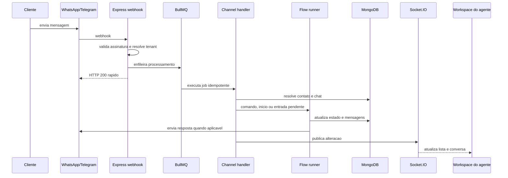
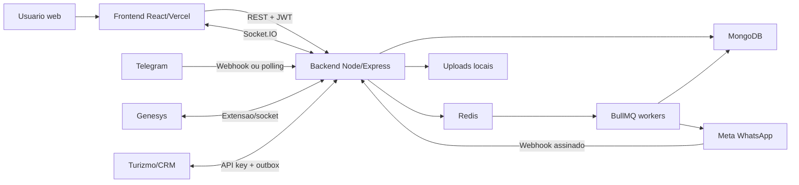
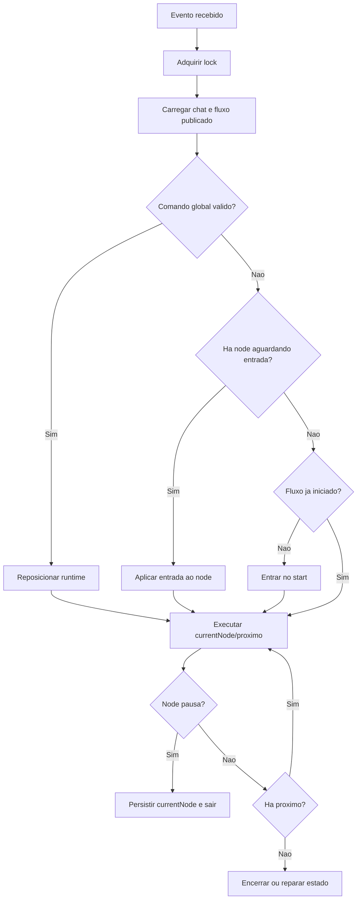
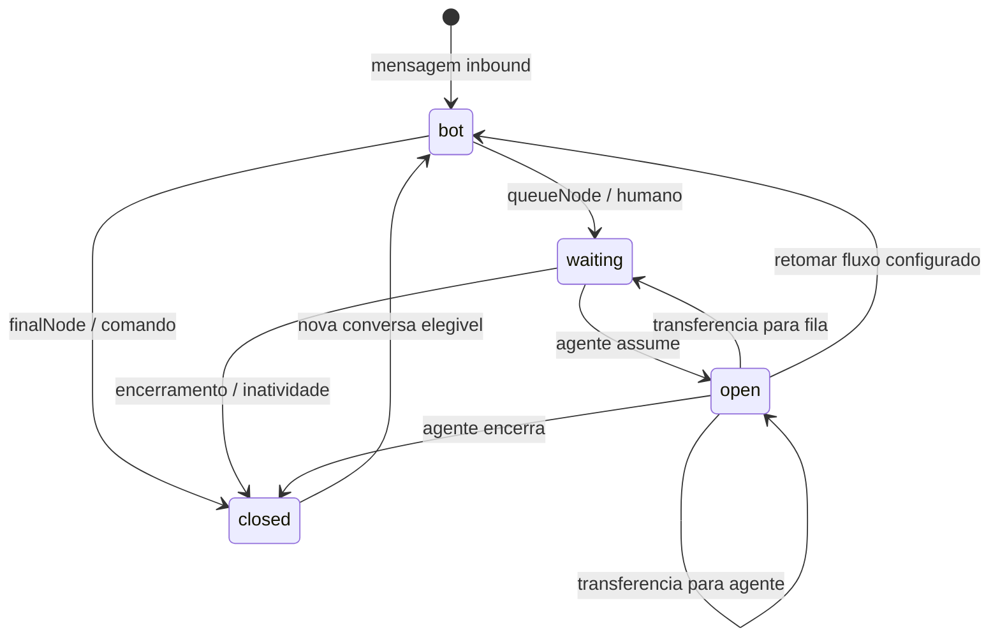
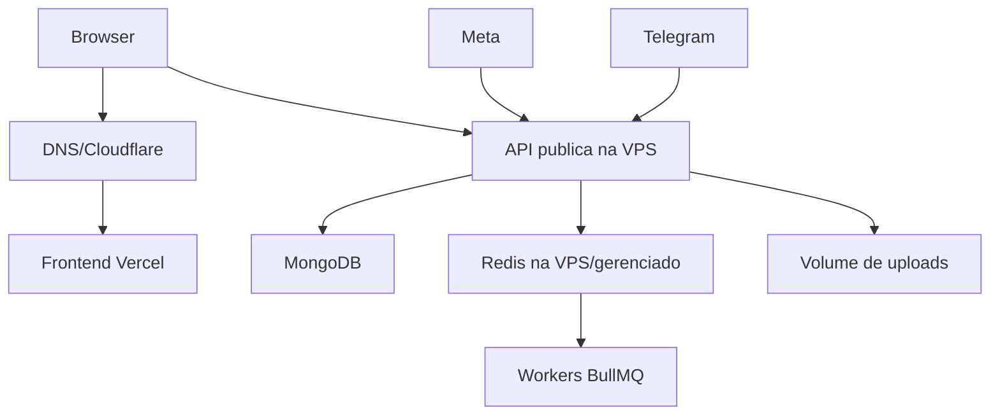

# Onion Web Flows: guia tecnico e arquitetural completo

> Documento de estudo aprofundado da aplicacao, baseado no codigo existente no repositorio em agosto de 2026.
>
> Este texto descreve o comportamento implementado, as decisoes arquiteturais observadas, os limites conhecidos e caminhos de evolucao. Quando uma capacidade existe apenas como desenho ou proposta, ela e identificada explicitamente como **planejada**.

---

## Sumario

1. [Objetivo e escopo](#1-objetivo-e-escopo)
2. [Visao executiva](#2-visao-executiva)
3. [Glossario do dominio](#3-glossario-do-dominio)
4. [Arquitetura de alto nivel](#4-arquitetura-de-alto-nivel)
5. [Organizacao do repositorio](#5-organizacao-do-repositorio)
6. [Inicializacao do backend](#6-inicializacao-do-backend)
7. [Arquitetura do frontend](#7-arquitetura-do-frontend)
8. [API, middlewares e contratos HTTP](#8-api-middlewares-e-contratos-http)
9. [Autenticacao, autorizacao e multi-tenancy](#9-autenticacao-autorizacao-e-multi-tenancy)
10. [Persistencia e modelo de dados](#10-persistencia-e-modelo-de-dados)
11. [Redis, BullMQ, cache e concorrencia](#11-redis-bullmq-cache-e-concorrencia)
12. [Tempo real e Socket.IO](#12-tempo-real-e-socketio)
13. [Editor de fluxos](#13-editor-de-fluxos)
14. [Formato e ciclo de vida de um fluxo](#14-formato-e-ciclo-de-vida-de-um-fluxo)
15. [Motor de execucao](#15-motor-de-execucao)
16. [Referencia completa dos nos](#16-referencia-completa-dos-nos)
17. [Variaveis, interpolacao e segredos](#17-variaveis-interpolacao-e-segredos)
18. [Ciclo de vida do chat](#18-ciclo-de-vida-do-chat)
19. [WhatsApp](#19-whatsapp)
20. [Telegram](#20-telegram)
21. [Atendimento humano](#21-atendimento-humano)
22. [Midia e arquivos](#22-midia-e-arquivos)
23. [Contatos, catalogo e templates](#23-contatos-catalogo-e-templates)
24. [Campanhas, cadencias e atendimento ativo](#24-campanhas-cadencias-e-atendimento-ativo)
25. [Classificacao, roteamento e tarefas comerciais](#25-classificacao-roteamento-e-tarefas-comerciais)
26. [Integracoes Turizmo e Genesys](#26-integracoes-turizmo-e-genesys)
27. [Analytics, relatorios e metricas](#27-analytics-relatorios-e-metricas)
28. [Seguranca](#28-seguranca)
29. [LGPD, retencao e privacidade](#29-lgpd-retencao-e-privacidade)
30. [Observabilidade e operacao](#30-observabilidade-e-operacao)
31. [Testes, sandbox e carga](#31-testes-sandbox-e-carga)
32. [Deploy e topologia de producao](#32-deploy-e-topologia-de-producao)
33. [Decisoes arquiteturais](#33-decisoes-arquiteturais)
34. [Riscos e divida tecnica](#34-riscos-e-divida-tecnica)
35. [Roadmap recomendado](#35-roadmap-recomendado)
36. [Como estender a plataforma](#36-como-estender-a-plataforma)
37. [Inventarios de referencia](#37-inventarios-de-referencia)
38. [Diagnostico operacional](#38-diagnostico-operacional)
39. [Roteiro de estudo](#39-roteiro-de-estudo)
40. [Mapa de fontes](#40-mapa-de-fontes)

---

## 1. Objetivo e escopo

O Onion Web Flows e uma plataforma multi-tenant de automacao conversacional e atendimento humano. Ela combina:

- editor visual de fluxos;
- motor de execucao orientado a nos;
- integracao com WhatsApp Cloud API e Telegram;
- atendimento por agentes em tempo real;
- contatos, filas, templates, catalogo e variaveis;
- campanhas e cadencias de contato ativo;
- classificacao e roteamento comercial;
- analytics, auditoria, relatorios e administracao;
- integracoes server-to-server, principalmente Turizmo e Genesys;
- infraestrutura assincrona com Redis e BullMQ;
- persistencia principal em MongoDB, com adaptadores auxiliares para JSON local e Supabase.

Este documento responde cinco perguntas centrais:

1. **O que existe?** Modulos, paginas, rotas, colecoes, filas, eventos e nos.
2. **Como funciona?** Sequencia de chamadas e mudancas de estado.
3. **Por que foi feito assim?** Decisoes e compromissos arquiteturais.
4. **Onde pode falhar?** Concorrencia, seguranca, escala e compatibilidade.
5. **Como evoluir?** Prioridades e padroes para novas implementacoes.

O documento nao substitui testes, contratos de API nem leitura do codigo. Ele funciona como indice tecnico e modelo mental.

---

## 2. Visao executiva

### 2.1 O problema resolvido

A plataforma recebe mensagens de canais externos, identifica o tenant e o contato, encontra ou cria um chat, decide se a conversa pertence ao bot ou a um agente e executa a proxima acao. A acao pode enviar mensagem, capturar entrada, chamar API, aguardar, entrar em fila, disparar template, manipular variaveis ou finalizar.

Paralelamente, o frontend oferece:

- operacao de chats;
- criacao e publicacao de fluxos;
- configuracao de canais e equipe;
- analise historica e operacional;
- administracao global por super-admin.

### 2.2 Principio estrutural

O sistema e organizado em quatro planos:

| Plano | Responsabilidade | Exemplos |
|---|---|---|
| Controle | Configura o comportamento | fluxos, canais, filas, templates, variaveis |
| Execucao | Processa conversas e jobs | `flowRunner`, handlers, workers BullMQ |
| Estado | Persiste dados e progresso | MongoDB, `activeChats`, `chatMessages`, Redis |
| Apresentacao | Expoe operacao e administracao | React, React Flow, dashboards, workspace do agente |

### 2.3 Fluxo principal resumido



### 2.4 Dimensao aproximada

No inventario realizado para este documento, os nucleos de backend e frontend somavam aproximadamente 54 mil linhas de codigo, sem contar dependencias, artefatos de deploy, uploads e documentacao. Isso explica por que alteracoes aparentemente locais podem atravessar varios subsistemas.

---

## 3. Glossario do dominio

| Termo | Significado na aplicacao |
|---|---|
| Tenant | Organizacao cliente isolada logicamente das demais |
| Contato | Pessoa externa identificada por telefone, WA ID ou identificador de canal |
| Chat | Instancia de conversa e estado de execucao |
| Canal | Integracao concreta, como um numero WhatsApp ou bot Telegram |
| Flow/Fluxo | Grafo direcionado de nos e conexoes |
| Draft | Versao editavel ainda nao publicada |
| Published | Snapshot executavel do fluxo |
| Node/No | Unidade de comportamento do fluxo |
| Edge/Conexao | Direcao de transicao entre nos |
| Case | No visual que representa uma saida condicional |
| Root variable | Variavel configurada no tenant e disponivel ao fluxo; na interface, tende a ser apresentada como variavel de atendimento |
| Secure variable | Valor privado, indisponivel para interfaces de agente e exportacoes |
| Queue/Fila | Destino operacional para atendimento humano |
| Active outreach | Conversa iniciada ativamente por agente/campanha |
| Campaign | Disparo coordenado para varios contatos |
| Cadence | Sequencia temporal de tentativas ou acoes comerciais |
| WTN | WhatsApp Template Node, capaz de enviar template oficial ou interativo |
| Provider message ID | Identificador da mensagem no provedor, usado para idempotencia e status |
| Outbox | Registro persistente de evento de integracao antes da entrega externa |
| Dead letter | Job ou evento que esgotou tentativas automaticas |
| TME | Tempo medio de espera do cliente antes de um agente assumir |
| SUPER_ADMIN | Papel global da plataforma |
| ADMIN | Administrador de um tenant |
| MANAGER | Gestor operacional/analitico do tenant |
| AGENT | Atendente humano |

---

## 4. Arquitetura de alto nivel

### 4.1 Componentes



### 4.2 Frontend

O frontend e uma SPA React 19 compilada pelo Vite. O React Router organiza paginas publicas, rotas globais de super-admin, rotas por tenant e areas de agente. React Flow sustenta o editor visual. Socket.IO atualiza conversas e indicadores em tempo real. Framer Motion e usado de forma pontual para transicoes.

### 4.3 Backend

O backend e uma aplicacao Node.js ESM com Express. A API monta rotas por dominio e delega comportamento para servicos. O processo principal tambem inicializa workers quando Redis/BullMQ estao habilitados; em uma implantacao maior, esses workers podem e devem ser separados em processos PM2 distintos.

### 4.4 Banco e estado efemero

MongoDB guarda estado duravel. Redis atende cache, locks distribuidos e backend das filas BullMQ. O adaptador de banco permite um armazenamento JSON para sandbox, mas esse modo nao oferece as garantias de concorrencia ou desempenho de producao.

### 4.5 Servicos externos

- Meta Graph API para WhatsApp;
- Telegram Bot API;
- Turizmo para ecossistema comercial;
- Genesys para mensageria/operacao externa;
- Vercel para frontend;
- VPS para backend, workers, Redis e arquivos locais;
- MongoDB como persistencia principal.

---

## 5. Organizacao do repositorio

### 5.1 Raiz

| Caminho | Papel |
|---|---|
| `index.js` | composicao e boot do servidor |
| `database.js` | acesso historico/auxiliar ao banco |
| `db/DatabaseAdapter.js` | abstracao de persistencia e indices |
| `src/config` | leitura e validacao de configuracao |
| `src/middleware` | autenticacao, rate limit, correlation ID e protecoes |
| `src/routes` | contratos HTTP por dominio |
| `src/services` | regras de negocio e integracoes |
| `src/queues` | declaracao e publicacao de filas BullMQ |
| `src/workers` | consumidores de jobs |
| `src/utils` | criptografia, PII, validacoes e utilitarios |
| `client` | aplicacao React |
| `tests` | testes automatizados do backend e motor |
| `load-tests` | cenarios k6 |
| `scripts` | migracoes, seeds, tuneis, smoke tests e operacao |
| `sandbox` | ambiente local isolado |
| `uploads` | arquivos persistidos localmente pelo backend |
| `docs` | documentacao tecnica, privacidade e integracoes |

### 5.2 Regra pratica de leitura

Para entender uma funcionalidade, siga esta ordem:

1. pagina/componente em `client/src`;
2. chamada em `client/src/services/api.js`;
3. rota em `src/routes`;
4. servico em `src/services`;
5. persistencia em `DatabaseAdapter`;
6. evento Socket.IO emitido;
7. handler correspondente no frontend.

Essa sequencia evita interpretar a interface como fonte de verdade. A autorizacao e a regra definitiva devem estar no backend.

---

## 6. Inicializacao do backend

### 6.1 Ordem conceitual

O boot em `index.js` executa, em linhas gerais:

1. carrega variaveis de ambiente antes dos modulos dependentes;
2. cria o adaptador de banco;
3. conecta ao MongoDB ou backend selecionado;
4. garante indices;
5. inicializa Redis quando habilitado;
6. repara estados de chat no boot, se configurado;
7. inicializa log de alteracoes de banco;
8. cria filas e workers BullMQ;
9. inicia workers comerciais e campanhas;
10. inicia watchers de runtime, delay, inatividade e retencao;
11. configura Express, seguranca e parsers;
12. monta rotas;
13. cria HTTP server e Socket.IO;
14. passa a aceitar conexoes;
15. registra encerramento gracioso.

### 6.2 Por que a ordem importa

- Rotas nao devem aceitar trafego antes de o banco estar pronto.
- Workers nao devem consumir jobs sem acesso a persistencia.
- O corpo bruto do webhook do WhatsApp precisa ser preservado antes do parser alterar sua representacao, pois a assinatura HMAC cobre os bytes originais.
- O Socket.IO precisa compartilhar o mesmo servidor HTTP para usar o mesmo host e politica de origem.
- O encerramento deve parar consumo de jobs antes de fechar banco e Redis.

### 6.3 Middlewares globais

O servidor utiliza:

- `trust proxy = 1`, necessario quando esta atras de proxy reverso;
- correlation ID por requisicao;
- compressao HTTP;
- Helmet e Content Security Policy;
- CORS com origens permitidas explicitamente;
- parser JSON geral com limite menor;
- limite maior apenas para upload base64;
- captura de `rawBody` na rota do webhook WhatsApp;
- rate limit global de API;
- tratamento central de erros.

### 6.4 Health checks

| Endpoint | Uso |
|---|---|
| `/health` | estado resumido da aplicacao |
| `/health/live` | processo esta vivo |
| `/health/ready` | dependencias essenciais estao prontas |

Liveness nao deve depender de uma consulta pesada. Readiness deve falhar se o servico nao consegue atender com seguranca, por exemplo quando o banco obrigatorio esta indisponivel.

---

## 7. Arquitetura do frontend

### 7.1 Shell da aplicacao

`client/src/App.jsx` concentra:

- roteamento principal;
- carregamento preguiçoso de paginas;
- layout autenticado;
- sidebar e header;
- selecao de tenant;
- conexao Socket.IO;
- notificacoes;
- prefetch ocioso de chunks;
- fallback de atualizacao periodica.

O lazy loading reduz o JavaScript inicial. O custo e a necessidade de garantir que os assets com hash continuem disponiveis durante deploys; remover imediatamente chunks antigos pode gerar `Failed to fetch dynamically imported module` em abas abertas.

### 7.2 Contextos

#### AuthContext

Responsavel por:

- restaurar usuario e token;
- login e logout;
- heartbeat de sessao;
- papel atual;
- limpeza de sessao quando o backend retorna 401.

O token fica em `localStorage`. Isso simplifica SPA e chamadas cross-origin, mas aumenta o impacto de XSS. A evolucao recomendada e token de acesso curto em memoria e refresh token em cookie `HttpOnly`, `Secure` e `SameSite` adequado.

#### TenantContext

Mantem o tenant selecionado. Para usuario comum, o tenant vem da identidade autenticada. Para super-admin, a selecao e explicita e e persistida localmente para navegacao.

### 7.3 Cliente HTTP

`client/src/services/api.js`:

- escolhe a URL base via `VITE_API_URL`;
- prefixa `/api`;
- adiciona `Authorization: Bearer <token>`;
- adiciona `tenantId` quando necessario;
- usa credenciais quando configurado;
- interpreta respostas JSON e erros;
- trata 401 e desafios de MFA.

Uma requisicao do frontend normalmente produz preflight CORS porque envia `Authorization` e, em alguns casos, metodos como `PATCH`. Por isso, a lista `Access-Control-Allow-Methods` do backend precisa incluir todos os verbos usados.

### 7.4 Roteamento por papel

Destino inicial observado:

| Papel | Pagina principal |
|---|---|
| `SUPER_ADMIN` | dashboard global |
| `ADMIN` | monitoramento/administracao do tenant |
| `MANAGER` | analytics/gestao |
| `AGENT` | workspace de atendimento |

O frontend esconde opcoes sem permissao, mas isso e apenas UX. O backend valida toda rota protegida.

### 7.5 Areas funcionais

As rotas incluem, entre outras:

- dashboard de super-admin;
- administracao de tenant e faturamento;
- monitoramento e analytics;
- historico e relatorios;
- fluxos e editor;
- canais, templates, variaveis e catalogo;
- equipe, usuarios, filas e expediente;
- workspace, dashboard e atendimento ativo do agente;
- seguranca, auditoria, incidentes e uso;
- campanhas, inbox comercial, cadencias e integracoes;
- documentacao e privacidade.

### 7.6 Estado em tempo real

O Socket.IO recebe eventos e os converte em eventos internos da interface. O frontend atualiza:

- ordem dos cards de chat;
- contagem de nao lidas;
- mensagens abertas;
- status de entrega;
- atribuicao/transferencia;
- fechamento;
- erros de WhatsApp;
- logs e notificacoes.

Existe polling de seguranca para recuperar divergencias. Socket e o caminho rapido; polling e reconciliacao, nao substituto permanente.

### 7.7 Editor e historico local

O editor mantem snapshots locais de nos, edges e blocos visuais. Undo/redo possui limite e debounce para nao registrar cada pixel de arraste. Uma guarda de alteracoes nao salvas intercepta navegacao e `beforeunload`.

---

## 8. API, middlewares e contratos HTTP

### 8.1 Convencoes

- Recursos ficam sob `/api`.
- Identidade e enviada por JWT Bearer.
- Tenant pode vir do token, query ou cabecalho, conforme papel e integracao.
- Rotas de listagem devem paginar e projetar campos.
- Erros devem retornar JSON estruturado e nao stack trace ao cliente.
- Operacoes destrutivas exigem autorizacao reforcada e, em alguns casos, confirmacao de senha.

### 8.2 Familias de rotas

| Prefixo | Dominio |
|---|---|
| `/api/auth` | login, heartbeat, MFA, logout |
| `/api/tenants` | tenant e configuracoes |
| `/api/users` | equipe e papeis |
| `/api/flows` | CRUD, publicacao, historico e rollback |
| `/api/variables` | variaveis de atendimento |
| `/api/templates` | templates internos, WhatsApp e interativos |
| `/api/schedules` | expedientes |
| `/api/queues` | filas e agentes alocados |
| `/api/channels` | canais e roteamento de fluxo |
| `/api/chats` | atendimento e historico |
| `/api/contacts` | contatos, bulk e outreach |
| `/api/catalog` | itens do catalogo |
| `/api/media` | ativos e upload |
| `/api/whatsapp` | webhook e operacoes WhatsApp |
| `/api/telegram` | webhook/polling Telegram |
| `/api/analytics` | metricas analiticas |
| `/api/reports` | exportacoes e relatorios |
| `/api/system` | saude operacional e filas |
| `/api/outreach` | ecossistema de contato ativo |
| `/api/cadences` | cadencias comerciais |
| `/api/classifications` | IA e classificacao |
| `/api/attendance-routing` | regras de roteamento |
| `/api/integrations` | integracoes genericas |
| `/api/integrations/turizmo` | ponte Turizmo |
| `/api/tasks` | tarefas comerciais |
| `/api/documentation` | conteudo publico/privado de documentacao |

### 8.3 Correlation ID

Cada request recebe ou reutiliza um identificador de correlacao. Ele deve aparecer em logs e respostas de erro. Para diagnostico distribuido, um mesmo ID deve acompanhar enfileiramento e job sempre que possivel.

### 8.4 Rate limiting

O limite global protege abuso geral. Webhooks oficiais e rotas de teste controladas podem ter tratamento especifico. Rotas sensiveis devem possuir limites menores e por identidade, nao apenas por IP, porque proxies e NAT compartilham enderecos.

### 8.5 Compatibilidade

O backend preserva formatos historicos em varios pontos, principalmente chats com mensagens embutidas e campanhas com itens embutidos. Essa compatibilidade e intencional durante migracao, mas deve ter prazo para ser removida apos backfill validado.

---

## 9. Autenticacao, autorizacao e multi-tenancy

### 9.1 Login

O login:

1. normaliza identificador;
2. consulta usuario;
3. avalia tentativas e anomalias;
4. compara senha com bcrypt;
5. verifica status do usuario;
6. exige TOTP quando aplicavel;
7. emite JWT;
8. registra acesso;
9. devolve perfil sanitizado.

Senhas legadas em texto puro devem ser rejeitadas ou migradas, nunca aceitas silenciosamente.

### 9.2 JWT

O token inclui identificador de usuario, tenant e papel. A cada requisicao, o middleware valida assinatura/expiracao e recarrega o usuario do banco. Isso impede que um token continue com privilegio antigo depois de o usuario ser desativado ou rebaixado.

Limite atual: logout no cliente remove o token, mas nao existe revogacao intrinseca de JWT ja emitido. Operacoes de alto risco devem usar token curto, `sessionVersion` ou lista de revogacao.

### 9.3 Papeis

| Papel | Escopo esperado |
|---|---|
| `SUPER_ADMIN` | plataforma inteira, tenants e diagnostico global |
| `ADMIN` | configuracao completa do proprio tenant |
| `MANAGER` | operacao, equipe e analise conforme permissoes |
| `AGENT` | chats atribuidos, fila, contatos e painel pessoal |

### 9.4 Resolucao do tenant

Para usuarios normais, o tenant efetivo deve vir do usuario autenticado. Parametros enviados pelo cliente nao podem trocar esse escopo. Super-admin pode selecionar tenant explicitamente. Integracoes server-to-server usam API key e tenant associado ou cabecalhos validados.

### 9.5 Super-admin reforcado

O acesso global pode combinar:

- JWT com papel `SUPER_ADMIN`;
- allowlist de IP com suporte CIDR/faixa;
- TOTP;
- auditoria de acesso;
- permissoes granulares;
- tokens externos vinculados a papel e tenant.

Quando Cloudflare/proxy e usado, a extracao do IP precisa confiar apenas em proxies conhecidos. Confiar cegamente em `X-Forwarded-For` permite spoofing.

### 9.6 Regra de ouro multi-tenant

Toda consulta de dado de negocio deve incluir `tenantId`, exceto colecoes realmente globais e rotas explicitamente super-admin. IDs previsiveis ou conhecidos nao substituem o filtro de tenant.

---

## 10. Persistencia e modelo de dados

### 10.1 DatabaseAdapter

`db/DatabaseAdapter.js` oferece uma API comum para:

- buscar um ou varios documentos;
- contar;
- inserir;
- atualizar;
- excluir;
- obter/salvar colecao;
- criar indices;
- medir consultas lentas.

Adaptadores observados:

| Adaptador | Uso |
|---|---|
| MongoDB | principal em producao |
| JSON local | sandbox e testes funcionais |
| Supabase/document REST | caminho auxiliar/transicional, nao fonte principal atual |

### 10.2 Por que MongoDB faz sentido hoje

Fluxos, configuracoes de nodes, variaveis e payloads de integracao sao naturalmente documentais. O esquema evolui com frequencia e cada tenant pode usar configuracoes diferentes. MongoDB reduz friccao nesse dominio.

MongoDB nao dispensa modelagem. Arrays de mensagens e itens de campanha dentro de documentos cresceram demais; por isso foram separados em colecoes proprias.

### 10.3 Colecoes centrais

#### Identidade e tenant

- `tenants`
- `users`
- `tenantSettings`
- `tenantModuleSettings`
- `adminIpAllowlist`
- `adminAccessAudit`
- `mfaSessions`
- `loginAttempts`
- `userLoginIps`

#### Automacao

- `flows`
- `flowSnippets`
- `flowTestSessions`
- `variables`
- `templates`
- `messageTemplates`
- `whatsappTemplates`
- `whatsappInteractiveTemplates`
- `schedules`
- `queues`
- `tags`
- `webhooks`
- `cannedResponses`
- `channelConfigs`

#### Conversa

- `activeChats`
- `chatMessages`
- `chatEvents`
- `contacts`
- `mediaAssets`
- `catalogItems`
- `telegramSessions`

#### Comercial

- `outreachCampaigns`
- `outreachCampaignItems`
- `contactOutreachHistory`
- `messageClassifications`
- `cadences`
- `cadenceExecutions`
- `contactSuppression`
- `commercialTasks`
- `attendanceRoutingProfiles`
- `attendanceRoutingDecisions`
- `outreachMetricEvents`
- `aiPromptVersions`

#### Integracao e operacao

- `integrationOutbox`
- `integrationInboundRequests`
- `systemLogs`
- `webVitals`
- `tenantIncidents`
- `tenantAuditEvents`
- `automationLibraryItems`

### 10.4 `activeChats` como estado leve

O documento de chat guarda:

- identidade: `id`, `tenantId`, contato e canal;
- estado: `status`, fila, agente, timestamps;
- runtime: `currentNodeId`, `flowStarted`, `resumeNodeId`, delay e contexto;
- dados: `vars`, `secureVars`, nomes de segredos;
- resumo: ultima mensagem, horario, quantidade e nao lidas;
- deduplicacao: IDs recentes do provedor.

Ele nao deve voltar a acumular todo o historico de mensagens.

### 10.5 `chatMessages`

Cada mensagem e independente e contem, conforme o caso:

- `tenantId`, `chatId`, `messageId`;
- remetente;
- texto;
- midia;
- botoes;
- metadados;
- timestamp;
- ID e status do provedor.

Beneficios:

- append atomico;
- paginacao;
- atualizacao de status sem regravar chat inteiro;
- indices por chat/tempo;
- menor risco de limite de documento;
- menor payload em listagens.

Chats antigos com `messages` embutidas ainda podem ser hidratados. O script de migracao move mensagens em lotes e so remove o array depois de validar.

### 10.6 Resumo de chat

Ao inserir mensagem, o sistema atualiza `lastMessage`, `lastMessageAt`, `messageCount` e, quando aplicavel, `unreadByAgentCount`. Esse padrao permite montar a lista do agente sem consultar todas as mensagens.

### 10.7 Campanhas normalizadas

`outreachCampaigns` guarda o resumo. `outreachCampaignItems` guarda um contato por item. Isso evita documento gigante, melhora retry individual e permite indices por campanha/status.

### 10.8 Indices

Os indices mais relevantes combinam `tenantId` com campos usados em filtro e ordenacao:

- chats por status/updatedAt;
- chats por agente/status;
- chats por fila/status;
- chat por canal/usuario;
- mensagens por chat/timestamp;
- mensagens por providerMessageId;
- fluxos por tenant/id;
- contatos por telefone, tags e identidade externa;
- campanhas por status/data;
- itens por campaign/status/data;
- logs e eventos por tenant/data;
- outbox por destination/status/nextAttemptAt.

Indice unique so deve ser criado apos verificar duplicatas. Para idempotencia opcional, indices parciais sao preferiveis.

---

## 11. Redis, BullMQ, cache e concorrencia

### 11.1 Funcoes do Redis

Redis nao substitui MongoDB. Ele atende:

1. backend de filas BullMQ;
2. locks distribuidos;
3. cache com TTL;
4. coordenacao temporaria entre processos.

### 11.2 Feature flags

O desenho preserva operacao sem Redis:

- `REDIS_ENABLED=false`: banco e execucao local continuam;
- `BULLMQ_ENABLED=false`: operacoes usam fallback sincrono/local;
- Redis indisponivel: warning e fallback quando seguro.

Fallback melhora disponibilidade, mas reduz capacidade e garantias distribuidas. Em producao com varias instancias, desabilitar Redis pode reintroduzir corridas.

### 11.3 Filas

Filas observadas:

| Fila | Trabalho |
|---|---|
| WhatsApp webhook | processar payload inbound fora do request HTTP |
| WhatsApp send | enviar texto, template ou midia |
| Outreach campaign | processar item de campanha |
| Lead classification | classificar resposta/intencao |
| Cadence scheduler | avaliar passos de cadencia vencidos |
| Turizmo events | entregar outbox ao Turizmo |
| Metrics aggregation | agregar eventos para analytics |

### 11.4 Job seguro

Um job deve possuir:

- ID deterministico quando existe chave de idempotencia;
- numero limitado de tentativas;
- backoff exponencial ou adequado ao provedor;
- timeout;
- log estruturado;
- estado persistente antes e depois;
- tratamento de falha permanente.

Exemplo: o webhook recebe `providerMessageId`, cria job com identidade derivada, responde 200 e o worker verifica novamente se a mensagem ja foi processada. Job duplicado torna-se inofensivo.

### 11.5 Concorrencia

Concorrencia global do worker aumenta throughput. Concorrencia dentro do mesmo chat pode corromper ordem. Por isso:

- jobs de chats diferentes podem executar em paralelo;
- operacoes do mesmo chat usam lock;
- canal+usuario tambem pode ser travado durante resolucao/criacao;
- workers devem renovar ou concluir lock antes do TTL;
- transacoes logicas verificam estado depois de adquirir lock.

### 11.6 Locks

Ha dois niveis:

- fila local de Promises para serializar no mesmo processo;
- lock Redis distribuido para varias instancias.

O lock e reentrante no mesmo contexto assincrono para evitar deadlock quando um servico chama outro que protege o mesmo chat.

### 11.7 Cache

Leituras frequentes candidatas e implementadas incluem:

- fluxo publicado;
- configuracao de canal;
- settings do tenant;
- templates WhatsApp/interativos;
- filas e configuracoes estaveis.

Regras:

- TTL curto;
- chave sempre inclui tenant;
- cache miss busca banco;
- falha no Redis nao impede leitura do banco;
- salvar/publicar invalida chave correspondente;
- segredos nunca sao expostos ao frontend nem logados.

### 11.8 Outbox e backoff

A outbox grava o evento antes de chamar integracao externa. O worker busca apenas eventos `pending` ou `retry` com `nextAttemptAt <= now`. Isso garante que:

- `delivered` nao seja reenviado;
- `dead_letter` nao volte sozinho;
- retry respeite espera;
- job duplicado nao force reprocessamento.

---

## 12. Tempo real e Socket.IO

### 12.1 Conexao

O frontend abre Socket.IO usando a mesma base da API. O servidor:

1. limita conexoes por IP;
2. valida JWT no handshake;
3. recarrega usuario;
4. determina tenant e papel;
5. entra em rooms autorizadas.

### 12.2 Rooms

| Room | Destinatarios |
|---|---|
| `tenant:<tenantId>` | interfaces daquele tenant |
| `agent:<userId>` | agente especifico |
| `user:<userId>` | usuario especifico |
| `role:SUPER_ADMIN` | super-admins |
| room de extensao Genesys | cliente de extensao associado |

Super-admin pode assinar tenant selecionado. Usuario comum nao pode entrar em room de outro tenant.

### 12.3 Eventos principais

| Evento | Consequencia de UI |
|---|---|
| `new_message` | adiciona/reconcilia mensagem e move chat para o topo |
| `new_chat` | adiciona conversa |
| `new_chat_in_queue` | atualiza espera |
| `agent_assigned` | atualiza responsavel e estado |
| `chat_closed` | remove/fecha chat |
| `chat_event` | atualiza timeline operacional |
| `message_delivery` | atualiza sent/delivered/read/failed |
| `new_log` | alimenta logs/notificacoes |
| `whatsapp_error` | toast e alerta traduzido |

### 12.4 Duplicacao visual

O agente pode inserir otimisticamente uma mensagem antes da confirmacao. Quando o socket devolve a versao persistida, a reconciliacao deve usar `messageId` ou `providerMessageId`, nao concatenar cegamente. Ausencia dessa deduplicacao produz duplicacao apenas visual.

### 12.5 Recuperacao

Sockets podem desconectar, perder eventos ou reconectar apos sleep. Ao reconectar, a tela deve refazer GET resumido e, para chat aberto, buscar mensagens posteriores ao ultimo timestamp/ID conhecido.

---

## 13. Editor de fluxos

### 13.1 Base tecnologica

O editor usa React Flow para:

- canvas;
- nodes customizados;
- handles;
- edges;
- selecao;
- zoom e pan;
- drag/drop;
- fit view.

O componente principal e grande porque concentra canvas, toolbar, modais, historico, lint, publicacao, snippets, teste e recursos comerciais. Essa concentracao e um ponto importante de refatoracao.

### 13.2 Tipos visuais registrados

`startNode`, `endNode`, `finalNode`, `messageNode`, `inputNode`, `holderNode`, `setValueNode`, `secretNode`, `conditionNode`, `anchorNode`, `gotoNode`, `scriptNode`, `httpRequestNode`, `templateNode`, `whatsappTemplateNode`, `delayNode`, `queueNode`, `scheduleNode`, `ratingNode`, `commandNode`, `mediaNode`, `catalogNode`, `menuNode`, `sequentialNode`, `commercialNode` e `caseNode`.

### 13.3 Categorias da toolbar

- base de fluxo;
- comunicacao;
- logica;
- dados e integracao;
- controle de fluxo.

O `commercialNode` e exclusivo de super-admin e visual. `caseNode` normalmente e gerado por outro node e nao deve ser criado como operacao independente.

### 13.4 Selecao e produtividade

O editor suporta:

- box selection;
- indicador visual de selecao;
- copiar/colar nodes e grupos;
- atalhos;
- menu de acoes por `Alt`;
- blocos visuais de fundo;
- duplicacao;
- exclusao protegida do start;
- undo/redo;
- fit/zoom e modo de apresentacao;
- preview no hover;
- badges de configuracao.

### 13.5 Nodes derivados

Condition, menu e schedule podem criar case nodes e edges estruturais. A fonte de verdade deve ser a configuracao do node pai. Reconciliacao precisa remover duplicatas e preservar conexoes externas dos cases existentes.

### 13.6 Start node

O start e unico e indestrutivel. Sua funcao e ponto de entrada, nao mensagem. O runtime nao deve enviar o label do start ao cliente.

### 13.7 Blocos visuais

Blocos agrupam visualmente uma regiao e um titulo, sem alterar o runtime. A versao atual e deliberadamente simples: fundo documental, sem transformar o grupo em subfluxo.

### 13.8 Comercial node

E usado para animacoes de marketing no canvas:

- keyframes de posicao, tamanho, forma e cor;
- interpolacao e duracao;
- fantasmas editaveis/ocultaveis;
- timeline global;
- conexoes animadas configuraveis;
- multiplas saidas.

No motor de negocio, ele e pass-through. Nunca deve alterar uma conversa real.

---

## 14. Formato e ciclo de vida de um fluxo

### 14.1 Documento

Um fluxo contem, conceitualmente:

```json
{
  "id": "f_exemplo",
  "tenantId": "tenant_exemplo",
  "name": "Atendimento principal",
  "description": "...",
  "draft": {
    "nodes": [],
    "edges": [],
    "visualBlocks": []
  },
  "published": {
    "nodes": [],
    "edges": [],
    "visualBlocks": [],
    "version": 3,
    "publishedAt": "..."
  }
}
```

Campos exatos podem variar por compatibilidade. Posicao e dimensoes pertencem ao editor; `data` contem configuracao executavel.

### 14.2 Draft

Salvar atualiza o rascunho. Conversas em producao nao devem executar draft.

### 14.3 Publicacao

Publicar:

1. valida estrutura e permissoes;
2. normaliza nodes/edges;
3. preserva segredos ja armazenados quando o frontend envia mascara;
4. cria snapshot published;
5. incrementa versao;
6. registra historico;
7. invalida cache de runtime.

### 14.4 Historico e rollback

Snapshots permitem inspecionar publicacoes e restaurar versao. Rollback e acao de alto impacto e exige papel autorizado, confirmacao em modal e senha. Restaurar deve criar nova publicacao, nao apagar historia.

### 14.5 Exportacao e importacao

Exportar serve para backup/duplicacao. Valores de `secretNode` precisam sair como `***`. Importar `***` nunca deve sobrescrever o valor real ja salvo. Em um novo tenant, o operador deve preencher novamente cada segredo.

### 14.6 Lint

O lint deve detectar:

- node sem entrada quando deveria ser alcancavel;
- saida ausente;
- multipla saida proibida;
- case orfao;
- goto sem anchor;
- IDs duplicados;
- start ausente ou duplicado;
- configuracao obrigatoria vazia;
- node desativado com transicao ambigua;
- ciclos potencialmente infinitos;
- segredo referenciado mas nao configurado.

Lint reduz erro editorial, mas o runtime ainda precisa ser defensivo.

---

## 15. Motor de execucao

### 15.1 Entrada

`src/services/flowRunner.js` e o nucleo. Ele pode ser acionado por:

- nova conversa;
- mensagem do usuario;
- resposta de node pendente;
- comando global;
- retomada de delay;
- retorno do atendimento humano;
- teste controlado.

### 15.2 Algoritmo conceitual



### 15.3 Loop de execucao

Nodes automaticos podem ser atravessados na mesma chamada. Nodes que aguardam usuario, horario, delay ou agente persistem estado e encerram a iteracao. Deve existir limite de passos para impedir loop infinito causado por grafo ciclico sem pausa.

### 15.4 Estado persistido

Campos relevantes:

- `currentNodeId`;
- `currentNodeEnteredAt`;
- `flowStarted`;
- `resumeNodeId` e `resumePending`;
- `delayNodeId`, `delayNextNodeId`, `delayUntil`;
- `sequentialContext`;
- tentativas de input;
- contexto de catalogo;
- `vars` e `secureVars`.

### 15.5 Node inexistente

Se o ID persistido nao existe na versao publicada atual, o runner registra o problema e aplica reset seguro. Isso pode acontecer quando um fluxo e publicado removendo um node usado por chat ativo. Uma evolucao mais forte e vincular cada chat a versao publicada iniciada.

### 15.6 Nodes desativados

Um node desativado pode ser pulado se houver exatamente uma saida deterministica. Se houver zero ou multiplas saidas, pular seria ambiguo e deve gerar problema.

### 15.7 Test mode

Sessao de teste deve:

- usar estado isolado;
- nao enviar WhatsApp/Telegram real;
- nao executar HTTP externo;
- nao entrar em fila humana real;
- pular ou simular delay;
- mascarar segredos;
- impor limite de passos/tempo.

O simulador nunca deve receber `secureVars` reais.

### 15.8 Eventos de runtime

Eventos de chat registram marcos como inicio, entrada em node relevante, fila, agente, timeout, finalizacao e erro. Nao e necessario persistir cada transicao trivial se o volume inviabilizar analytics; eventos importantes devem ser consistentes.

---

## 16. Referencia completa dos nos

### 16.1 Tabela operacional

| Node | Operacao conceitual | Pausa | Saidas | Efeito principal |
|---|---|---:|---:|---|
| Start | `GOTO_FLOW_START` | nao | 1 | inicia no primeiro edge |
| End/Final | `GOTO_FLOW_END` | finaliza | 0 | envia final opcional e fecha/reset |
| Message | `SET_CLIENT_MESSAGE` | nao | 1 | envia texto interpolado |
| Input | `SET_VAR_FROM_CLIENT_INPUT` | sim | normal/erro | solicita, valida e salva resposta |
| Holder | `SET_VAR_FROM_CLIENT_STREAM` | sim | saida ao liberar | acumula uma ou mais mensagens |
| Set Value | `SET_FLOW_VARIABLE` | nao | 1 | define variavel |
| Secret | `SET_SECURE_VARIABLE` | nao | 1 | injeta valor privado no runtime |
| Condition | `GOTO_BY_CONDITION` | nao | cases/else | escolhe primeira condicao verdadeira |
| Anchor | `SET_FLOW_ANCHOR` | nao | 1 | alvo nomeado de goto/comando |
| Goto | `GOTO_FLOW_ANCHOR` | nao | logica | salta para anchor |
| Command | `GOTO_BY_GLOBAL_COMMAND` | depende | 1 | registra comando global |
| Script | `DO_SCRIPT_TRANSFORM` | nao | 1 | transforma `vars` em sandbox |
| HTTP Request | `DO_HTTP_REQUEST` | nao | sucesso/erro | chama API e mapeia resposta |
| Template | `SET_CLIENT_INTERNAL_TEMPLATE` | opcional | cases | envia menu/template interno |
| WTN | `SET_CLIENT_WHATSAPP_CONTENT` | opcional | 1 ou resposta | envia template/interativo WhatsApp |
| Delay | `DO_WAIT_DURATION` | sim | 1 | agenda retomada |
| Queue | `GOTO_HUMAN_QUEUE` | sim | retomada | coloca chat em espera humana |
| Schedule | `GOTO_BY_SCHEDULE` | nao | dentro/fora | ramifica por expediente |
| Rating | `SET_AGENT_RATING` | sim | 1 | captura nota de 1 a 5 |
| Media | `SET_CLIENT_MEDIA` | nao | 1 | envia imagem/video/audio/documento |
| Catalog | `SET_CLIENT_CATALOG` | opcional | 1 | mostra itens e pode capturar escolha |
| Menu | `GOTO_BY_CLIENT_OPTION` | sim | cases/else ou unica | captura opcao e ramifica |
| Sequential | `DO_SEQUENTIAL_STEPS` | depende | 1 | executa subetapas locais |
| Case | `GOTO_CASE_TARGET` | nao | 1 | ponte visual de ramo |
| Commercial | `DO_PRESENTATION_ANIMATION` | nao | multiplas | apenas visual; runtime passa adiante |

### 16.2 Start

- Deve existir uma unica vez.
- Nao e apagavel.
- Nao envia o texto `Inicio`.
- Segue a saida `default`.
- Multiplas saidas indicam fluxo invalido.

### 16.3 Message

- Interpola placeholders antes do envio.
- Persiste a mensagem de bot.
- Envia ao canal real quando nao esta em teste.
- Emite socket.
- Continua automaticamente.

Texto vazio deve ser validado no editor; no runtime, nao deve gerar mensagem fantasma.

### 16.4 Input

Configuracoes relevantes:

- prompt;
- nome da variavel;
- tipo/validador;
- regex customizada;
- mensagem de erro;
- maximo de tentativas;
- ramo de falha.

Validadores incluem nenhum, email, telefone, CPF, CNPJ, numero, data e regex. A resposta original normalmente e string; converter para numero exige operacao explicita ou validacao com coercao definida.

### 16.5 Holder

Resolve o caso em que o bot precisa permanecer parado sem consumir apenas a primeira mensagem. Pode:

- guardar ultima mensagem;
- guardar lista;
- concatenar texto;
- contar mensagens;
- liberar por palavra/comando;
- enviar fallback uma vez ou repetidamente.

Comandos globais continuam podendo retirar o usuario do holder se configurados.

### 16.6 Set Value

Define valor literal ou interpolado. Deve preservar tipos quando a configuracao declara JSON/numero/booleano; se tudo passa por textarea, valores podem chegar como strings.

### 16.7 Secret

- So super-admin pode criar/editar.
- Valor e cifrado no banco quando a chave de criptografia esta configurada.
- Leitura e exportacao devolvem `***`.
- `***` em save/publicacao significa preservar, nao gravar asteriscos.
- Runtime descriptografa e guarda em `secureVars`.
- Agente, simulador, logs e variaveis visiveis nunca recebem o valor.

### 16.8 Condition

Avalia condicoes em ordem e escolhe a primeira verdadeira. Operadores incluem igualdade, diferenca, maior/menor e `contains`. Valor vazio em igualdade representa comparacao com string vazia, nao `undefined` ou `null`, salvo normalizacao especifica.

Os case nodes exibem apenas valor ou operador+valor para reduzir poluicao. O `else` e fallback.

### 16.9 Anchor e Goto

Anchor da nome a um ponto. Goto busca esse nome. Nome duplicado e ambiguo; nome inexistente deve produzir lint e log em runtime.

### 16.10 Command

Registra comando que pode ser acionado globalmente, como `#reiniciar`, `#humano` ou `#encerrar`. Para evitar roubar respostas de menus, comandos sem prefixo podem ser restringidos em nodes interativos.

### 16.11 Script

O codigo recebe objetos controlados:

```js
vars.TOTAL = Number(vars.PRECO || 0) * Number(vars.QUANTIDADE || 0);
```

O backend:

- faz parse AST;
- bloqueia construcoes perigosas;
- executa em `vm` sem `require`, `process` ou rede;
- bloqueia geracao dinamica de codigo/WASM;
- limita tempo, aproximadamente centenas de milissegundos;
- copia de volta apenas estado permitido.

`vm` nao e uma fronteira de seguranca formal para codigo hostil. O acesso ao editor reduz risco, mas a evolucao correta e worker isolado/processo/container com limites de CPU e memoria.

### 16.12 HTTP Request

Configuracoes:

- metodo;
- URL interpolada;
- headers em JSON;
- body;
- timeout;
- mapeamentos de resposta;
- saida de sucesso e erro.

Antes de chamar, o runtime monta contexto privado com segredos. `Authorization: Bearer {SECRET}` e valido quando o header JSON esta correto.

Variaveis padrao incluem:

- `HTTP_STATUS`;
- `HTTP_OK`;
- `HTTP_RAW`;
- `HTTP_ERROR_MESSAGE`.

Mapeamento usa caminho por pontos. Para array raiz, caminho como `0.id` aponta ao primeiro item. Para guardar resposta inteira, o destino deve receber o valor raiz conforme a convencao do modal.

URLs passam por validacao SSRF. O node deve impedir acesso a loopback, rede privada e metadados de cloud, salvo allowlist consciente.

### 16.13 Template interno

Representa conteudo reutilizavel da propria aplicacao. No escopo de fluxo, pode ser menu com botoes. Mensagens rapidas de agente pertencem a configuracao da equipe/atendimento, embora historicamente compartilhem conceitos.

### 16.14 WTN

Possui dois modos:

1. template aprovado pela Meta;
2. interactive message dentro da janela permitida.

Template oficial precisa de nome, idioma, componentes e quantidade/nome de parametros exatos. Interactive list/reply buttons nao exige aprovacao, mas depende da janela de conversa e limites da API.

Pode salvar:

- texto da resposta;
- payload/row ID;
- texto do botao.

### 16.15 Delay

Persiste horario de retomada e encerra execucao atual. Watcher ou job futuro retoma a partir do `delayNextNodeId`. Nao deve manter `setTimeout` longo como unica fonte, pois restart perderia o timer.

### 16.16 Queue

Define status de espera, fila, instante inicial e node de retomada. Pode enviar mensagem de espera. Um agente assume posteriormente. Ao finalizar atendimento, o sistema decide entre encerrar ou retomar, conforme `continueFlowAfterQueue` e origem da conversa.

### 16.17 Schedule

Avalia dia/horario no timezone do tenant, com padrao `America/Sao_Paulo`. Ramifica para dentro ou fora do expediente. Datas devem ser comparadas no timezone de negocio, nao timezone da VPS.

### 16.18 Rating

Solicita nota de 1 a 5, salva valor e pode atualizar estatisticas do agente associado. Precisa lidar com atendimento sem agente e nota repetida.

### 16.19 Media

Envia imagem, video, audio ou documento por URL/ativo. GIF pode ser convertido/tratado como video no WhatsApp. O node nao realiza upload por si so; referencia ativo previamente armazenado ou URL valida.

### 16.20 Catalog

Itens podem vir da colecao do tenant ou configuracao manual. Com botoes, espera escolha e define variaveis como:

- `<PREFIX>_ID`;
- `<PREFIX>_NOME`;
- `<PREFIX>_PRECO`;
- `<PREFIX>_DESCRICAO`;
- `<PREFIX>_SKU`;
- `<PREFIX>_CATEGORIA`.

Sem botoes, e showcase e deve seguir imediatamente. Esse detalhe evita travamento historico.

### 16.21 Menu

Envia pergunta, aguarda entrada e reconhece numero, ID ou label. Pode salvar variavel e valor associado. Ramificacoes sao opcionais:

- ativas: cada opcao vai a case;
- desativadas: todas seguem uma unica saida.

Else e opcional. Sem else, entrada invalida permanece aguardando e pode mostrar `Selecione uma opcao valida`.

### 16.22 Sequential

Agrupa etapas locais de mensagem, input e menu numa configuracao unica. O contexto persistido indica indice atual e estado da subetapa. E util para formularios lineares, mas nao e subflow global:

- nao possui versao independente;
- nao e reutilizado por varios fluxos;
- copiar o node duplica configuracao;
- seu ciclo de vida pertence ao fluxo pai.

### 16.23 Case

E ponte visual e estrutural. O parent decide qual case usar; o case apenas segue sua conexao externa. IDs devem ser estaveis para nao quebrar conexoes ao editar condicoes.

### 16.24 End/Final

Pode enviar mensagem final configurada, limpar estado pendente, fechar chat e registrar evento. Encerramento humano e encerramento ativo podem usar mensagem especifica ou modo silencioso e nao devem cair por acidente em finalNode antigo.

---

## 17. Variaveis, interpolacao e segredos

### 17.1 Fontes de variavel

1. configuracao do tenant;
2. entrada de cliente;
3. nodes Set/Script/HTTP/Catalog/Menu/Rating;
4. variaveis de sistema;
5. segredos;
6. aliases de integracao.

### 17.2 Variaveis de sistema

O runtime disponibiliza, conforme canal:

- `CHANNEL`;
- `CHAT_ID`;
- `TENANT_ID`;
- `CHANNEL_USER_ID`;
- `CHANNEL_CHAT_ID`;
- `WA_ID`;
- `TG_ID`;
- `CUSTOMER_CPF` quando aplicavel.

### 17.3 Interpolacao

Placeholders seguem forma `{NOME}` e podem acessar caminhos aninhados, inclusive arrays. A interpolacao ocorre em texto, URLs, headers e bodies controlados.

Exemplo:

```json
{
  "authorization": "Bearer {SECRET}",
  "wa_id": "{WA_ID}",
  "status": "{HTTP_STATUS}"
}
```

Se um placeholder nao e reconhecido e chega literal, verificar:

- se esta em `vars` ou aliases globais;
- se o node usa o interpolador correto;
- se a grafia/case coincide;
- se o valor e seguro e, portanto, so esta disponivel em contexto privado.

### 17.4 Tipos

Inputs de chat chegam como string. Mesmo que o usuario digite `5`, `typeof vars.NUMERO_PEDIDO` sera `string`. Converta conscientemente:

```js
const quantidade = Number(vars.QUANTIDADE_PEDIDO);
if (Number.isFinite(quantidade)) {
  vars.QUANTIDADE_PEDIDO_NUM = quantidade;
}
```

Arrays precisam ser arrays reais. Para compatibilidade com string JSON:

```js
if (!Array.isArray(vars.ITENS_PEDIDO)) {
  try {
    vars.ITENS_PEDIDO = JSON.parse(vars.ITENS_PEDIDO || "[]");
  } catch {
    vars.ITENS_PEDIDO = [];
  }
}
```

### 17.5 Dinheiro

Mantenha valor numerico separado da apresentacao:

```js
vars.TOTAL_PEDIDO_NUM = Number(vars.TOTAL_PEDIDO_NUM || 0) + valor;
vars.TOTAL_PEDIDO_BRL = vars.TOTAL_PEDIDO_NUM.toLocaleString("pt-BR", {
  style: "currency",
  currency: "BRL"
});
```

Envie `_NUM` em APIs que esperam numero e `_BRL` em mensagens.

### 17.6 Fronteira dos segredos

Segredo pode aparecer somente em:

- armazenamento cifrado;
- memoria privada do backend durante execucao autorizada;
- request externo montado no servidor.

Nunca em:

- resposta de API de fluxo;
- JSON exportado;
- simulador;
- socket;
- workspace do agente;
- logs;
- analytics;
- variaveis visiveis.

---

## 18. Ciclo de vida do chat

### 18.1 Estados principais

| Estado | Significado |
|---|---|
| `bot` | motor controla a proxima resposta |
| `waiting` | aguardando agente/fila |
| `open` | atendimento humano em andamento |
| `closed` | encerrado |

### 18.2 Maquina de estado simplificada



### 18.3 Criacao/resolucao

O handler procura chat ativo por tenant, canal e usuario. Se nao encontra, cria contato/chat, define identidade de canal e inicia fluxo publicado roteado para aquele canal.

### 18.4 Handoff humano

Ao entrar em fila:

- `status = waiting`;
- `queue` recebe destino;
- `waitingSince` inicia TME;
- `resumeNodeId` pode guardar continuacao;
- socket notifica agentes elegiveis.

Ao assumir:

- `status = open`;
- `agentId/agentName` sao definidos;
- espera termina;
- evento e persistido;
- mensagem operacional opcional e enviada ao cliente;
- workspace recebe estado atualizado.

### 18.5 Encerramento

Variantes:

- finalizacao pelo fluxo;
- finalizacao pelo agente com mensagem;
- finalizacao silenciosa;
- inatividade global/node;
- opt-out;
- comando global;
- encerramento em massa por super-admin.

Fechamento precisa ser idempotente. Duas solicitacoes concorrentes nao devem enviar duas mensagens nem reabrir fluxo.

### 18.6 Atendimento ativo

Quando um template inicia contato:

- cria ou reutiliza chat de outreach;
- atribui agente quando token pertence a agente;
- marca origem ativa;
- bloqueia texto livre ate resposta do cliente quando a janela exige;
- resposta do cliente permanece no atendimento humano e nao inicia fluxo;
- fila pode aparecer como `ATIVO`.

### 18.7 Estado inconsistente

`chatStateGuard` detecta/repara combinacoes como:

- `open` sem agente;
- `waiting` com agente indevido;
- `bot` com fila humana ativa;
- `closed` com node pendente;
- outreach ativo e bot executando simultaneamente.

Reparo no boot e runtime reduz pontas soltas, mas nao substitui transicoes atomicas.

---

## 19. WhatsApp

### 19.1 Configuracao de canal

Uma entrada de canal inclui identidade operacional, tenant, plataforma, credenciais e roteamento. Para WhatsApp, os dados tipicos sao:

- access token;
- phone number ID;
- WABA ID quando necessario para listar templates;
- app secret para validar assinatura;
- verify token para handshake;
- fluxo publicado associado;
- estado habilitado.

WABA ID e o identificador da conta WhatsApp Business, nao o telefone do cliente.

### 19.2 Verificacao GET

A Meta chama GET com mode, verify token e challenge. O backend compara o token da configuracao resolvida e devolve o challenge. O endpoint pode resolver tenant por query ou procurar configuracao correspondente quando a URL e global.

### 19.3 Webhook POST

Etapas:

1. captura corpo bruto;
2. le `x-hub-signature-256`;
3. resolve app secret/configuracao;
4. calcula HMAC SHA-256;
5. compara em tempo constante;
6. bloqueia replay curto da mesma assinatura;
7. extrai phone number IDs, mensagens e statuses;
8. resolve tenant por phone number ID;
9. enfileira processamento;
10. responde 200.

Sem assinatura valida, deve retornar 403. Uma configuracao errada do app secret produz `Assinatura invalida` mesmo com webhook chegando.

### 19.4 Processamento inbound

O handler:

- ignora mensagem ja processada;
- serializa por canal/usuario e chat;
- resolve configuracao;
- normaliza perfil e contato;
- baixa midia quando aplicavel;
- persiste mensagem;
- emite socket;
- verifica atendimento humano/outreach;
- tenta comando global;
- inicia ou continua fluxo.

### 19.5 Mensagens interativas

Reply button e list reply entregam:

- texto visivel;
- ID/payload da opcao.

O runtime pode salvar ambos. Branch por payload e mais estavel que texto, pois emojis e labels podem mudar.

### 19.6 Saida

O servico de API suporta:

- texto;
- imagem;
- video;
- audio;
- documento;
- template aprovado;
- interactive list;
- reply buttons.

Cada envio persiste mensagem local, provider ID e status inicial. Webhooks posteriores atualizam `sent`, `delivered`, `read` ou `failed`.

### 19.7 Templates aprovados

O request precisa corresponder exatamente ao template:

- nome;
- idioma;
- header/body/buttons presentes;
- numero de parametros;
- parametros nomeados quando o template usa nomes;
- indice correto de botoes.

Erros Meta devem registrar template, idioma, esperado versus fornecido e resumo de componentes, nunca valores secretos.

### 19.8 Janela de conversa

Interactive messages e texto livre dependem da janela de atendimento permitida. Fora dela, inicia-se com template aprovado. Depois que o cliente responde, o atendimento pode continuar dentro da janela.

### 19.9 Limites de midia

O backend pode aceitar upload de ate 70 MB, mas isso nao altera limites da Meta. Exemplo observado: video pode ser rejeitado acima de 16 MiB com erro 131053. Validacao de UI deve considerar limite por canal/tipo, nao apenas limite do servidor.

---

## 20. Telegram

### 20.1 Modos

- webhook;
- polling com `getUpdates`.

Eles nao podem operar simultaneamente no mesmo bot. Se webhook esta ativo, `getUpdates` retorna conflito. A configuracao por canal decide o modo; uma flag global pode servir apenas como default.

### 20.2 Resolucao de tenant

O bot/configuracao deve apontar a um tenant. Token e secret sao armazenados no backend. Webhook recebe tenant ou resolve por configuracao.

### 20.3 Handler

O Telegram usa o mesmo motor:

- resolve chat;
- persiste mensagens;
- trata comandos;
- processa input;
- envia texto/midia/botoes compativeis;
- respeita atendimento humano.

### 20.4 Diferencas

- formato de botoes e callback e diferente;
- media IDs/URLs seguem Telegram;
- polling exige checkpoint de update ID;
- templates Meta nao se aplicam;
- nodes nao suportados devem pular ou usar fallback explicitamente.

---

## 21. Atendimento humano

### 21.1 Workspace

O workspace do agente inclui:

- lista de conversas;
- ordenacao por atividade;
- badge de nao lidas;
- conversa selecionada;
- composer;
- upload de midia/documento;
- painel colapsavel de informacoes;
- mensagens rapidas;
- WA ID/telefone;
- variaveis permitidas;
- assumir, transferir e encerrar.

No mobile, o layout funciona como aplicativo de mensagens: lista e conversa ocupam telas alternadas, composer permanece acessivel e detalhes sao secundarios.

### 21.2 Nome exibido

Prioridade recomendada e implementada na interface:

1. nome do contato salvo no tenant;
2. WA ID/telefone;
3. identificador do canal;
4. fallback `Visitante` apenas quando nada existe.

O nome nao deve ser confundido com nome do agente.

### 21.3 Mensagens

- texto preserva quebras de linha;
- `Enter` envia;
- `Shift+Enter` quebra linha;
- colagem multiline preserva formato;
- imagens mostram preview;
- audio mostra player;
- video e documento usam representacao adequada;
- horario possui espacamento;
- status de entrega aparece em mensagens outbound.

### 21.4 Assumir todos

A operacao em massa pode assumir atendimentos em espera e enviar primeira mensagem ou template interno. Deve validar limite, fila elegivel e permissao; cada chat precisa ser processado isoladamente para uma falha nao abortar os demais.

### 21.5 Transferencia

Pode enviar para:

- outra fila;
- outro agente nao-admin elegivel.

Transferencia registra origem/destino, atualiza rooms e pode enviar ao cliente mensagem em italico. Eventos puramente internos permanecem como banners do workspace.

### 21.6 Dashboard do agente

Metricas:

- atendimentos do dia/mes;
- TME do dia/mes;
- nota e media;
- historico pessoal;
- volume e distribuicao.

TME mede espera ate o agente assumir, nao duracao total do atendimento.

---

## 22. Midia e arquivos

### 22.1 Upload

O backend recebe base64 em rota dedicada, valida tamanho, tipo declarado e assinatura real do arquivo, grava com nome aleatorio em `uploads/<tenantId>` e persiste metadados.

### 22.2 Tipos aceitos

- JPEG, PNG, WebP, GIF;
- MP4, WebM, QuickTime;
- MP3, OGG, WAV;
- PDF e documentos autorizados conforme validador.

SVG, HTML, JavaScript ou arquivo mascarado devem ser bloqueados.

### 22.3 Deteccao

Nao se confia apenas em extensao/MIME do navegador. O backend compara magic bytes com MIME declarado. Isso evita upload de HTML nomeado `.jpg`.

### 22.4 URL

Mensagens antigas podem guardar URL relativa (`/uploads/...`) e novas URL absoluta. O frontend normaliza ambas usando API base. Esse foi um ponto real de falha de previews.

### 22.5 Persistencia local

Arquivos locais na VPS exigem:

- volume persistente;
- backup;
- limite por tenant;
- limpeza por retencao;
- estrategia se houver varias instancias.

Para escala horizontal, migrar binarios para object storage S3-compativel e manter apenas metadados/URL no MongoDB.

---

## 23. Contatos, catalogo e templates

### 23.1 Contatos

Contatos sao isolados por tenant, nao por agente. Podem conter:

- ID interno;
- nome;
- telefones/WA ID;
- canal;
- tags;
- atributos de CRM;
- timestamps;
- identidade externa;
- estado de supressao em colecao propria.

### 23.2 Importacao em lote

Bulk aceita array de objetos. Cada item e validado e normalizado. Tags preservam texto, inclusive espacos e maiusculas; filtros em URL devem usar encoding, por exemplo `Campanha%205`.

Tenant nao deve ser “adivinhado” de query sem controle: ele e resolvido pelo token ou explicitamente para super-admin.

### 23.3 Exclusao em massa

Pode excluir todos ou por tag. Essa acao precisa:

- tenant explicito;
- papel forte;
- confirmacao;
- auditoria;
- preferencia por soft delete/supressao quando ha campanhas em andamento.

Apagar contato nao deve necessariamente apagar opt-out. Supressao e obrigacao operacional independente; para testes, deve existir limpeza admin consciente.

### 23.4 Catalogo

Itens incluem nome, descricao, preco, SKU, categoria, imagem e ativo. Imagens podem vir da biblioteca de midia. O node escolhe subconjunto e formato.

### 23.5 Templates internos

Sao conteudos reutilizaveis sob controle da aplicacao. Podem servir a fluxo ou atendimento. A interface deve separar esses escopos semanticamente.

### 23.6 Templates WhatsApp

O catalogo local sincroniza templates aprovados pela Meta usando WABA ID. Armazena ID externo, nome, idioma, categoria, status, componentes e placeholders. O ID local (`wa_tpl_...`) referencia o registro; o envio usa nome/idioma esperados pela Graph API.

### 23.7 Interativos

Tipos principais implementados:

- reply buttons;
- interactive list.

Outros tipos como produto/catalogo nativo dependem de catalogo Commerce e payloads especificos; nao devem ser misturados ao catalogo interno sem adaptador.

---

## 24. Campanhas, cadencias e atendimento ativo

### 24.1 Campanha

Campanha e um agregado leve com itens independentes. Criacao:

1. valida canal, template, remetente e contatos;
2. verifica limite do tenant;
3. cria resumo;
4. cria itens;
5. enfileira processamento;
6. retorna rapidamente.

### 24.2 Item

Cada item contem:

- tenant/campaign/contact;
- identidade telefonica;
- status;
- erro resumido;
- tentativas;
- timestamps;
- outreach/chat/provider IDs.

### 24.3 Processamento

Worker busca item pendente elegivel, verifica supressao e janela, monta parametros, envia, persiste resultado e incrementa contadores da campanha. Falha de um item nao invalida campanha inteira.

### 24.4 Limites

Ha limite funcional por campanha e limite tecnico. Campanha “gigante” nao e apenas numero absoluto: depende de taxa Meta, concorrencia, midia, quantidade de parametros e capacidade de workers. Dividir em lotes melhora controle e rollback.

### 24.5 Atendimento ativo individual

Endpoint de outreach de um contato recebe:

- canal;
- template ID;
- sender phone number ID quando ha mais de um;
- valores de header/body/buttons;
- agente derivado do token.

Token de agente faz o chat aparecer para aquele agente. Token admin/super-admin precisa de regra explicita de atribuicao; caso contrario, o chat pode ficar humano sem dono.

### 24.6 Cadencia

Cadencia define passos com atraso, janela e acao. O scheduler seleciona execucoes vencidas, enfileira e reavalia. Resposta positiva, opt-out, encerramento ou status final cancelam passos futuros conforme regra.

### 24.7 Follow-up

Nao e obrigatorio fechar chat para enviar novo template, mas regras da Meta determinam se texto livre ou template e permitido. O sistema deve evitar duplicar chats e manter historico do mesmo contato.

### 24.8 Supressao

Motivos incluem:

- opt-out explicito;
- contato invalido;
- bloqueio;
- hard bounce/falha permanente;
- regra comercial;
- exclusao com preservacao de compliance.

Opt-out deve interromper cadencias. Remover contato nao apaga automaticamente supressao.

---

## 25. Classificacao, roteamento e tarefas comerciais

### 25.1 Classificacao

Respostas podem ser classificadas por IA ou regra em:

- intencao;
- sentimento;
- confianca;
- proxima acao;
- necessidade de revisao.

O resultado deve guardar versao do prompt/modelo para auditoria.

### 25.2 Fallback de IA

Provedores podem ser encadeados. Chaves ficam no ambiente. O fallback e usado quando o provedor principal falha/expira, nao para enviar a mesma solicitacao simultaneamente sem necessidade. Dados pessoais enviados a terceiros precisam estar cobertos por contrato e politica.

### 25.3 Roteamento declarativo

Perfis de roteamento permitem reutilizar o comportamento em varias empresas. Condicoes podem considerar:

- origem/campanha;
- intencao;
- sentimento;
- confianca;
- opt-out;
- tenant/canal;
- horario.

Acoes:

- enfileirar;
- atribuir;
- suprimir;
- ignorar;
- criar tarefa;
- finalizar cadencia.

Decisoes sao persistidas de forma idempotente para explicar por que um lead entrou em determinada fila.

### 25.4 Tarefas

Tarefa comercial liga contato, campanha, responsavel, prazo, prioridade e status. Ela nao deve ser confundida com job BullMQ: tarefa e trabalho de negocio; job e processamento tecnico.

---

## 26. Integracoes Turizmo e Genesys

### 26.1 Turizmo inbound

Ponte server-to-server recebe eventos autenticados por API key e idempotency key. Funcoes incluem:

- sincronizar lead/contato;
- registrar campanha;
- reconciliar estado;
- acionar outreach;
- atualizar resultado.

Requests repetidos com a mesma idempotency key devem devolver o resultado anterior ou no-op seguro.

### 26.2 Turizmo outbound

O padrao outbox garante durabilidade:

1. transacao logica grava evento local;
2. worker seleciona evento vencido;
3. envia com autenticacao;
4. marca delivered ou retry;
5. backoff aumenta espera;
6. apos limite, dead letter;
7. circuit breaker reduz pressao quando destino falha.

O filtro de processamento, inclusive por `outboxId`, inclui status pendente/retry e `nextAttemptAt <= now`.

### 26.3 Genesys

A integracao usa extensao/socket para transportar eventos e comandos entre workspace/Genesys e Onion. Operacoes observadas incluem:

- associar cliente de extensao;
- upsert/backfill de conversa;
- propagar mensagem e midia;
- atualizar cliente;
- fechar atendimento;
- enviar comando de agente e receber acknowledgement.

Genesys nao deve escrever diretamente em colecoes internas. O adaptador traduz eventos para contratos de dominio.

### 26.4 Padrao para nova integracao

Toda integracao nova deve definir:

- autenticacao;
- escopo de tenant;
- idempotencia;
- contrato de evento;
- timeout e retry;
- outbox quando outbound critico;
- mascaramento de logs;
- reconciliacao;
- versao de payload.

---

## 27. Analytics, relatorios e metricas

### 27.1 Fontes

- `activeChats` para estado atual;
- `chatEvents` para transicoes;
- `chatMessages` para volume;
- campaigns/items para outreach;
- classifications/routing para comercial;
- users/queues para desempenho;
- web vitals para frontend;
- logs/incidents para saude.

### 27.2 Metricas operacionais

- conversas iniciadas e encerradas;
- bot versus humano;
- entrada por canal/fluxo/fila;
- tempo de espera;
- tempo de atendimento;
- abandono;
- transferencia;
- taxa de resolucao;
- notas;
- erros por node/canal;
- mensagens sent/delivered/read/failed;
- contatos suprimidos;
- campanha enviada/sucesso/falha/resposta.

### 27.3 TME

`assumedAt - waitingSince`, agregado apenas para chats que entraram em espera e foram assumidos. Nao usar `createdAt`, pois o bot pode conversar antes da fila.

### 27.4 CSV

Exportacao completa deve ser assincrona para periodos grandes. Um job gera arquivo e a interface notifica quando pronto. Colunas precisam ser documentadas, timezone explicito e dados sensiveis minimizados.

### 27.5 Web vitals

TTFB, LCP e outras metricas de navegador sao coletadas com pagina e rating. LCP alto pode ser rede, chunk, render, API bloqueante ou dispositivo. Poucas amostras nao sustentam conclusao estatistica.

---

## 28. Seguranca

### 28.1 Senhas

- bcrypt com custo configurado/observado em torno de 10;
- nunca retornar hash;
- rate limit de login;
- lockout por usuario;
- deteccao de IP/anomalia;
- confirmacao de senha para operacoes destrutivas.

### 28.2 Tokens JWT

- segredo vem de env;
- expiracao limitada;
- usuario e recarregado;
- papel e tenant sao verificados no backend;
- token nunca entra em query string;
- logs mascaram Authorization.

Melhoria: refresh token HttpOnly, rotacao e revogacao.

### 28.3 Segredos de API

Canal e secret node usam criptografia AES-256-GCM quando `DATA_ENCRYPTION_KEYS` esta presente. Key ring permite rotacao. Se chave nao existe, o fallback em texto puro e risco critico e deve impedir producao, nao apenas avisar.

### 28.4 Rotas administrativas

- `authenticate` valida identidade;
- `authorize` valida papel/permissao;
- `requireTenant` restringe escopo;
- super-admin pode exigir IP + TOTP;
- auditoria registra operacoes;
- frontend nao e fronteira de seguranca.

### 28.5 Logs e PII

Logger central mascara chaves conhecidas. Nao registrar:

- Authorization;
- access tokens;
- app secrets;
- secret node;
- senha;
- TOTP secret;
- corpo completo de mensagens;
- documento/midia base64.

Chamadas `console.*` dispersas podem contornar sanitizacao. Migrar todas para logger estruturado e prioridade alta.

### 28.6 CORS

CORS permite origens de frontend conhecidas e metodos usados. Ele nao autentica request. Clientes nao-browser, como curl, nao sao bloqueados por CORS; por isso JWT/API key continuam obrigatorios.

### 28.7 Webhooks

- WhatsApp: HMAC do raw body;
- Telegram: secret token;
- Turizmo: API key + idempotencia;
- replay protection;
- resposta rapida;
- payload maximo.

### 28.8 SSRF

HTTP node e fetch de midia podem atingir URLs controladas. Bloquear:

- localhost;
- redes RFC1918;
- link-local;
- metadata endpoints;
- esquemas nao HTTP(S);
- redirects para destino proibido.

### 28.9 Script sandbox

Mesmo com AST e `vm`, trate script como codigo privilegiado de administrador. Para multi-tenant self-service, isole em processo/container sem rede, filesystem, env e com quotas.

### 28.10 Upload

Validar magic bytes, tamanho e nome; servir com `nosniff` e disposition correta; nunca executar arquivo; idealmente usar dominio separado/object storage.

### 28.11 Risco especifico de TOTP

O modelo de usuario precisa remover explicitamente `totp.secret` de qualquer resposta. Remover apenas `password` nao e suficiente. Esta e uma verificacao de prioridade critica antes de venda ampla.

---

## 29. LGPD, retencao e privacidade

### 29.1 Papeis

Na operacao mais comum:

- cliente contratante: controlador dos dados dos clientes finais;
- Onion: operador seguindo instrucoes;
- Onion pode ser controlador independente para seguranca, faturamento e obrigacoes proprias.

### 29.2 Dados tratados

- nome;
- telefone/WA ID;
- historico de conversa;
- fila/agente/status;
- identificadores tecnicos;
- midia enviada voluntariamente;
- metricas operacionais.

CPF, dados de saude, financeiros ou documentos nao devem ser coletados por padrao. Se o fluxo do cliente exigir, deve haver avaliacao e contrato especifico.

### 29.3 Retencao

`dataRetentionWorker` aplica `chatRetentionDays` e politicas relacionadas. Ao apagar chat, deve remover:

- estado do chat;
- mensagens separadas;
- eventos;
- midias, quando a politica determinar;
- caches derivados.

### 29.4 Titulares

Devem existir processos para:

- localizar dados por telefone/identidade;
- exportar;
- corrigir;
- excluir/anonimizar;
- preservar registros legalmente obrigatorios;
- comunicar resultado ao controlador.

### 29.5 Suboperadores

Meta, Telegram, Vercel, VPS, MongoDB, provedores de IA, e-mail e DNS podem tratar dados. O contrato e politica precisam listar categorias, finalidade e transferencia internacional.

---

## 30. Observabilidade e operacao

### 30.1 Logs estruturados

Campos recomendados:

- timestamp;
- level;
- service/module;
- correlationId;
- tenantId;
- chatId;
- jobId/queueName;
- provider message ID mascarado quando necessario;
- durationMs;
- status/error code;
- mensagem resumida.

### 30.2 Logs de WhatsApp

Devem explicar:

- webhook atingiu rota;
- assinatura valida/invalida;
- tenant resolvido;
- tipos/quantidade de mensagens;
- chat resolvido;
- decisao bot/humano/outreach;
- node executado;
- request outbound;
- erro Meta traduzido;
- esperado versus recebido em template.

### 30.3 Slow query

Com `SLOW_QUERY_LOG_ENABLED` e `SLOW_QUERY_MS`, o adaptador registra colecao, operacao, duracao, tenant e tamanho aproximado, nunca corpo completo.

### 30.4 Filas

Endpoint protegido de sistema deve exibir:

- waiting;
- active;
- delayed;
- failed;
- completed recente;
- workers/concurrency;
- duracao media;
- Redis ready.

### 30.5 Alertas

Erros WhatsApp relevantes viram notificacao para super-admin, com texto amigavel e codigo tecnico nos detalhes. Alertas precisam de deduplicacao para nao gerar tempestade.

### 30.6 Watchers

- chat runtime watcher: repara/retoma estados;
- delay watcher: retoma delays vencidos;
- inactivity watcher: encerra por inatividade;
- data retention worker: limpa dados;
- commercial worker: processa cadencias/classificacoes/outbox.

Intervalos curtos demais pressionam banco. Consultas devem usar indices e buscar somente itens vencidos.

---

## 31. Testes, sandbox e carga

### 31.1 Testes automatizados existentes

Cobrem areas como:

- locks e guardas de chat;
- runtime de input;
- validacao;
- lint/editor;
- roteamento de atendimento;
- dominio comercial;
- finalizacao comercial;
- modulos de tenant;
- acesso a documentacao;
- ponte Turizmo.

### 31.2 Motor funcional de nodes

Fixtures JSON e checklist permitem validar cada node de forma isolada. O `.bat` exibe node e `PASS`. Isso e util para regressao, mas nao substitui integracao com canais reais.

### 31.3 Sandbox

O sandbox usa banco JSON local e credenciais de teste. Backend e frontend rodam em portas separadas e simulador WhatsApp produz/recebe chats. Ele e adequado para UX, testes de fluxo e stress visual, nao para concorrencia real de Mongo/Redis.

### 31.4 k6

Cenarios incluem:

- smoke de API;
- monitoramento de chats;
- webhook WhatsApp;
- rotas de leitura.

Um teste valido precisa:

- credencial dedicada;
- tenant de teste;
- rota habilitada;
- thresholds de falha e latencia;
- baseline antes/depois;
- observar CPU, memoria, Mongo e Redis simultaneamente.

### 31.5 Interpretacao

`p95=463ms` significa que 95% das requisicoes ficaram abaixo desse valor. `http_req_failed=100%` invalida conclusao de desempenho, pois medir login 401/500 nao mede a carga normal.

### 31.6 Testes faltantes prioritarios

- concorrencia de varias mensagens do mesmo chat;
- agente fechando enquanto webhook chega;
- publish removendo current node;
- Redis indisponivel durante enqueue;
- retry/idempotencia de outbox;
- mensagens separadas e status delivery;
- permissao multi-tenant em todas as rotas;
- redacao de segredos em cada resposta;
- reconexao socket com gap de mensagens;
- limites de midia por provedor.

---

## 32. Deploy e topologia de producao

### 32.1 Topologia atual



### 32.2 Frontend

Build Vite usa `VITE_API_URL`. Alterar a env exige novo deploy. Socket usa a mesma origem configurada; referencias antigas ao Render indicam build/env desatualizado.

### 32.3 Backend

Na VPS, uma operacao robusta usa:

- usuario nao-root;
- Node LTS;
- PM2/systemd;
- Nginx/Caddy como reverse proxy;
- HTTPS;
- firewall;
- processo API;
- processos worker separados;
- Redis protegido;
- volume persistente;
- rotacao de logs;
- backup.

### 32.4 Cloudflare Tunnel temporario

Quick tunnel muda URL quando reinicia. Serve para teste, mas obriga atualizar frontend e webhooks. Named tunnel com hostname fixo elimina esse problema. Produção nao deve depender de quick tunnel.

### 32.5 Estrategia de deploy

1. revisar diff e segredo;
2. executar testes/build;
3. criar artefato limpo do Git, nao copiar worktree inteiro;
4. backup de env e banco;
5. subir codigo em release directory;
6. instalar dependencias lockadas;
7. rodar migracoes/indices compativeis;
8. reiniciar workers e API graciosamente;
9. verificar health/readiness;
10. smoke test autenticacao, chat e webhook;
11. observar filas/logs;
12. manter release anterior para rollback.

### 32.6 Env por categoria

Nao documentar valores, apenas nomes e finalidade:

- servidor: porta, ambiente, URLs publicas;
- auth: JWT, expiracao, MFA/IP;
- banco: Mongo URL/database ou modo sandbox;
- Redis/BullMQ: URL, flags, concorrencias;
- canais: fallbacks WhatsApp/Telegram;
- criptografia: key ring;
- retencao;
- limites/rate limits;
- integracoes Turizmo/Genesys/IA;
- observabilidade/slow query;
- uploads.

---

## 33. Decisoes arquiteturais

### ADR-001: grafo de nodes persistido como documento

**Decisao:** armazenar nodes/edges em documento de fluxo.

**Motivo:** o editor trabalha naturalmente com snapshot JSON; configuracoes variam por node.

**Custo:** diffs e validacao sao mais complexos; documentos podem crescer; versionamento precisa snapshot.

### ADR-002: draft separado de published

**Decisao:** runtime executa snapshot publicado.

**Motivo:** edicao nao altera producao acidentalmente.

**Custo:** cache e rollback precisam invalidacao correta; chats em andamento podem enfrentar mudanca de versao.

### ADR-003: mesmo motor para varios canais

**Decisao:** handlers adaptam entrada/saida e compartilham `flowRunner`.

**Motivo:** evita duplicar logica de automacao.

**Custo:** nodes precisam declarar comportamento/fallback por canal.

### ADR-004: MongoDB como principal

**Decisao:** persistencia documental multi-tenant.

**Motivo:** flexibilidade de flows/configuracoes.

**Custo:** relatorios relacionais e integridade exigem disciplina; arrays grandes precisaram normalizacao.

### ADR-005: mensagens em colecao propria

**Decisao:** separar `chatMessages` de `activeChats`.

**Motivo:** escala, paginacao e append eficiente.

**Custo:** detalhes precisam hidratar e compatibilidade antiga aumenta complexidade temporaria.

### ADR-006: Redis/BullMQ opcional com fallback

**Decisao:** infraestrutura assincrona via flags.

**Motivo:** rollout seguro e desenvolvimento local simples.

**Custo:** dois caminhos de execucao precisam testes; fallback nao oferece mesma garantia distribuida.

### ADR-007: webhook responde antes do trabalho pesado

**Decisao:** validar, enfileirar e responder 200.

**Motivo:** provedores exigem baixa latencia e repetem em timeout.

**Custo:** observabilidade e idempotencia tornam-se obrigatorias.

### ADR-008: outbox para integracoes criticas

**Decisao:** persistir evento antes de enviar.

**Motivo:** nao perder efeitos externos em falha/restart.

**Custo:** consistencia eventual e necessidade de reconciliacao.

### ADR-009: Socket.IO com reconciliacao HTTP

**Decisao:** evento em tempo real mais polling/refetch.

**Motivo:** UX rapida sem assumir entrega perfeita de socket.

**Custo:** deduplicacao e ordenacao precisam ser robustas.

### ADR-010: secret node como contexto privado

**Decisao:** separar `vars` de `secureVars`.

**Motivo:** fluxo precisa usar token sem expor ao agente/editor/exportacao.

**Custo:** todo novo caminho de serializacao deve respeitar a fronteira.

### ADR-011: sequential node local, subflow ainda planejado

**Decisao:** agrupar passos sem introduzir fluxo global reutilizavel.

**Motivo:** formulario linear simples com menor risco de versao/recursao.

**Custo:** configuracoes podem ser duplicadas entre fluxos.

### ADR-012: estado humano e bot no mesmo chat

**Decisao:** transicao por status em um agregado.

**Motivo:** historico unico e continuidade.

**Custo:** corridas entre agente, webhook e runner exigem locks e guardas.

---

## 34. Riscos e divida tecnica

### 34.1 Criticos

1. **Possivel exposicao de TOTP secret:** respostas de usuario devem sanitizar estrutura aninhada.
2. **Criptografia opcional:** producao nao deve iniciar com segredos em texto puro.
3. **Script `vm`:** nao e sandbox hostil suficiente para editor aberto a clientes.
4. **Tokens em localStorage:** XSS compromete sessao.
5. **Uploads locais:** perda/indisponibilidade em escala horizontal sem storage externo.

### 34.2 Altos

1. `FlowEditor.jsx` e `flowRunner.js` grandes e acoplados.
2. Compatibilidade dupla de mensagens/campanhas aumenta caminhos de bug.
3. Muitas chamadas `console.*` podem vazar dados e fragmentar logs.
4. Chats nao parecem vinculados rigidamente a uma versao de fluxo.
5. API e workers podem compartilhar processo, causando interferencia sob carga.
6. Fallback sem Redis pode processar duplicado em varias instancias.
7. Nao ha transacao Mongo envolvendo todos os efeitos de algumas transicoes.

### 34.3 Medios

1. Paginas e rotas muito numerosas tornam permissoes dificeis de auditar.
2. Modulos historicos e novos podem coexistir com semantica duplicada.
3. SWR/Redux aparentam trechos legados ou inconsistentes.
4. Deploy Vercel pode invalidar chunks abertos.
5. Indices precisam ser monitorados por `explain`, nao apenas criados.
6. Relatorios grandes podem pressionar banco se gerados sincronicamente.
7. Cache invalidation depende de todos os writers chamarem o helper correto.

### 34.4 Produto/operacao

1. Limites da Meta podem ser confundidos com limites da plataforma.
2. Configuracao de canal possui muitos identificadores tecnicos.
3. Ausencia de onboarding/checklist pode gerar canal “pendente” sem explicacao.
4. Metricas precisam definicoes contratuais para evitar interpretacao divergente.
5. Multi-tenant aumenta impacto de qualquer query sem `tenantId`.

---

## 35. Roadmap recomendado

### P0: antes de ampliar vendas

- corrigir/sancionar TOTP secret em todas as respostas;
- exigir encryption keys em producao;
- teste automatizado de nao vazamento de secrets;
- auditoria sistematica de filtros `tenantId`;
- backup e restore testados;
- monitoramento/alerta de API, Mongo, Redis e workers;
- object storage ou backup forte para uploads;
- smoke test automatico apos deploy;
- contrato/DPA revisado por advogado.

### P1: estabilidade e escala imediata

- separar processos API e workers;
- concluir migracao de mensagens/campanhas antigas;
- paginacao cursor-based de mensagens;
- vincular chat a `flowVersion`;
- centralizar logger e eliminar console cru;
- dead-letter UI e retry manual auditado;
- reconciliacao socket por cursor;
- dashboard de filas BullMQ;
- testes de corrida por chat.

### P2: manutencao

- decompor FlowEditor em hooks/modulos de dominio;
- decompor flowRunner em registry de executores;
- schema versionado para nodes;
- OpenAPI gerada/testada;
- camada de repository por agregado;
- matriz central de permissao;
- feature flags persistidas por tenant;
- object storage com URLs assinadas.

### P3: produto avancado

- subflows versionados e reutilizaveis;
- marketplace/biblioteca de blocos;
- ambientes draft/staging/producao por tenant;
- replay controlado de eventos;
- state machine node somente apos semantica formal;
- billing/metering por uso;
- tracing distribuido OpenTelemetry;
- PostgreSQL analitico ou warehouse, sem migracao precipitada do core documental.

### 35.1 Migrar MongoDB para PostgreSQL?

Nao e requisito imediato para escalar. Primeiro:

- indices;
- projecoes;
- separacao de documentos grandes;
- cache;
- workers;
- observabilidade;
- limites e paginacao.

PostgreSQL e vantajoso para relacoes fortes, relatorios complexos e transacoes multi-entidade. Uma arquitetura hibrida pode manter flows/chats em Mongo e enviar eventos analiticos para PostgreSQL/warehouse.

---

## 36. Como estender a plataforma

### 36.1 Novo node

Checklist:

1. definir semantica, pausa e saidas;
2. adicionar tipo visual;
3. adicionar item de toolbar e permissao;
4. adicionar formulario no modal;
5. definir defaults e schema version;
6. implementar executor no runtime;
7. tratar canal nao suportado;
8. implementar lint;
9. incluir copy/export/import/redacao;
10. incluir teste e fixture funcional;
11. documentar variaveis geradas;
12. validar migracao de flows antigos.

### 36.2 Registry recomendado

Em vez de `if/switch` gigante:

```js
const nodeExecutors = {
  messageNode: executeMessage,
  inputNode: executeInput,
  conditionNode: executeCondition
};
```

Cada executor retorna contrato uniforme:

```js
{
  action: "continue" | "wait" | "close" | "error",
  nextNodeId: null,
  statePatch: {},
  emittedMessages: []
}
```

Isso facilita teste e state machine formal.

### 36.3 Novo canal

Implementar adaptador:

- `normalizeInbound`;
- `sendText`;
- `sendMedia`;
- `sendInteractive`;
- `extractIdentity`;
- `verifyWebhook`;
- `mapDeliveryStatus`;
- capacidades suportadas.

O `flowRunner` nao deve conhecer detalhes do SDK do canal.

### 36.4 Nova integracao externa

- rota inbound autenticada;
- schema Zod;
- idempotencia;
- service de dominio;
- outbox outbound;
- worker/retry;
- logs e metricas;
- documentacao de contrato;
- teste de replay e assinatura.

### 36.5 Nova colecao

- `tenantId` quando for dado de tenant;
- timestamps;
- IDs estaveis;
- indices baseados em queries reais;
- politica de retencao;
- serializacao segura;
- migracao/backfill;
- testes no adaptador Mongo e JSON se sandbox depender.

### 36.6 Nova pagina

- rota lazy;
- permissao no frontend e backend;
- tenant context;
- loading/error/empty state;
- API paginada;
- socket somente se realmente realtime;
- design operacional consistente;
- documentacao publica ou protegida conforme sensibilidade.

---

## 37. Inventarios de referencia

### 37.1 Operacoes de node por prefixo

| Prefixo | Uso |
|---|---|
| `SET` | altera mensagem, variavel ou estado local |
| `DO` | executa efeito, espera ou integracao |
| `GOTO` | controla transicao no grafo/estado |

### 37.2 Status de mensagem

| Status | Significado |
|---|---|
| queued/pending | aguardando envio local |
| sent | aceito pelo provedor |
| delivered | entregue ao dispositivo/destino |
| read | lida |
| failed | falha definitiva ou atual |

### 37.3 Eventos de chat

- `CHAT_OPENED`;
- `FLOW_STARTED`;
- `FLOW_NODE_ENTERED`;
- `FLOW_TIMEOUT`;
- `QUEUE_ENTERED`;
- `QUEUE_TRANSFERRED`;
- `AGENT_ASSUMED`;
- `AGENT_RELEASED`;
- `AGENT_CLOSED`;
- `CLOSED_BY_INACTIVITY`;
- `CUSTOMER_DISENGAGED`;
- `RESUME_TO_FLOW`;
- `ERROR`.

### 37.4 Estados comerciais

Campanha/item/cadencia possuem estados proprios como draft/pending/processing/paused/completed/failed/cancelled. Nomes exatos devem ser lidos nos schemas do modulo antes de integrar; nao reutilizar status de chat.

### 37.5 Configuracoes por env mais importantes

| Grupo | Exemplos de variaveis |
|---|---|
| Runtime | `NODE_ENV`, `PORT`, URLs publicas |
| Auth | segredo JWT, expiracao, flags TOTP/IP |
| Database | URI/nome Mongo, adapter |
| Redis | `REDIS_URL`, `REDIS_ENABLED`, `BULLMQ_ENABLED` |
| Workers | concorrencia por fila, tentativas/backoff |
| Locks | habilitacao, TTL, espera e retry |
| Cache | TTL de flow/channel/settings/templates |
| Query | `SLOW_QUERY_LOG_ENABLED`, `SLOW_QUERY_MS` |
| Security | `DATA_ENCRYPTION_KEYS`, allowed origins |
| Media | limite de upload, diretorio/base URL |
| Retention | dias de chat/log/midia |
| WhatsApp | defaults e versao Graph API |
| Telegram | defaults/polling |
| Turizmo | URL, API keys, retry/circuit breaker |
| AI | provedor, modelo, timeout, fallbacks |

Os nomes exatos devem ser conferidos em `.env.example`, `src/config/env.js` e acessos `process.env`. Nunca copiar valores para documentacao.

### 37.6 Artefatos de documentacao relacionados

- `ATTENDANCE_ROUTING.md`;
- `COMMERCIAL_RUNTIME_RUNBOOK.md`;
- `OUTREACH_ECOSYSTEM_API.md`;
- `OUTREACH_ROLLOUT_ROLLBACK.md`;
- `TURIZMO_EVENT_CONTRACT.md`;
- `TURIZMO_INBOUND_BRIDGE.md`;
- `SUBFLOW_DESIGN.md`;
- templates LGPD e privacidade;
- relatorios de hardening, scaling e revisao do motor na raiz.

---

## 38. Diagnostico operacional

### 38.1 Frontend nao carrega

Verificar:

1. documento e chunks no Network;
2. 404 de chunk dinamico apos deploy;
3. `VITE_API_URL`;
4. CORS/preflight;
5. heartbeat repetindo;
6. bundle com excecao JS;
7. service worker/cache/CDN;
8. endpoint lento bloqueando skeleton.

### 38.2 Login `Failed to fetch`

- confirmar URL API;
- testar OPTIONS;
- conferir `Access-Control-Allow-Origin` exato;
- conferir metodo/header permitido;
- testar health da API;
- inspecionar certificado/DNS;
- diferenciar CORS de 401/500.

### 38.3 WhatsApp recebe webhook mas bot nao responde

Procurar sequencialmente nos logs:

1. webhook hit;
2. assinatura valida;
3. payload parsed;
4. tenant/config resolved;
5. job criado/consumido;
6. dedupe;
7. chat resolved;
8. estado bot/humano;
9. flow resolved;
10. node executed;
11. outbound Meta response.

### 38.4 Mensagem nao aparece em tempo real

- confirmar persistencia em `chatMessages`;
- confirmar `new_message` emitido para room correta;
- conferir token/socket tenant;
- dedupe do frontend;
- reconexao;
- refetch do detalhe;
- URL relativa de midia.

### 38.5 Fluxo reinicia sozinho

Possiveis causas:

- `currentNodeId` limpo antes de aplicar input;
- chat duplicado para mesmo usuario;
- message ID processado duas vezes;
- publish removeu node atual;
- atendimento ativo nao marcado;
- corrida sem lock;
- comando global capturando texto;
- handler chama `startChatFlow` apos `applyUserInput`.

### 38.6 Delay trava

- conferir `delayUntil`;
- timezone/unidade;
- watcher/worker ativo;
- `delayNextNodeId` existente;
- query indexada de itens vencidos;
- lock expirado;
- restart e persistencia;
- logs de retomada.

### 38.7 Template Meta falha

- nome/idioma;
- status aprovado;
- WABA/phone correto;
- quantidade e nome de parametros;
- header media;
- botao URL/payload;
- access token/permissao;
- janela e tipo de mensagem;
- log `parameterSummary`.

### 38.8 API lenta

Separar:

- TTFB do frontend;
- preflight;
- DNS/TLS;
- tempo Express;
- query Mongo;
- espera de pool;
- job sincrono indevido;
- payload/serializacao;
- cold start inexistente na VPS, mas processo pode estar saturado.

Use `explain("executionStats")`, slow query logs, CPU/event loop lag, conexoes Mongo, Redis e fila.

### 38.9 Fila crescendo

- worker online;
- Redis ready;
- concurrency;
- rate limit externo;
- jobs delayed/retry;
- erro permanente repetido;
- lock contention;
- Mongo lento;
- dead letter.

### 38.10 Publicacao nao funciona

- resposta PATCH/POST;
- permissao e senha;
- lint bloqueante;
- payload grande;
- preservacao de secret `***`;
- versao/conflito;
- cache invalidado;
- published realmente atualizado no banco;
- runtime lendo tenant/flow correto.

---

## 39. Roteiro de estudo

### Nivel 1: produto

1. navegar por tenant, canais, fluxo e workspace;
2. criar fluxo mensagem -> input -> condicao -> final;
3. publicar e acompanhar chat;
4. assumir, transferir e fechar;
5. consultar historico e analytics.

### Nivel 2: frontend

1. `client/src/main.jsx` e `App.jsx`;
2. AuthContext/TenantContext;
3. `services/api.js` e socket;
4. workspace do agente;
5. FlowEditor e CustomNodes;
6. NodeConfigModal.

### Nivel 3: backend

1. `index.js`;
2. middleware auth/tenant;
3. rotas channels/chats/flows;
4. `whatsappHandler`;
5. `flowRunner`;
6. `chatMessages`, locks e state guard;
7. DatabaseAdapter.

### Nivel 4: escala

1. Redis client;
2. queues/workers;
3. campaign worker;
4. caches;
5. indices e slow query;
6. retention/migrations;
7. k6 e metricas.

### Nivel 5: seguranca

1. auth/JWT/TOTP;
2. tenant isolation;
3. crypto/secret node;
4. PII/logging;
5. webhook signatures;
6. SSRF/script/upload;
7. contratos LGPD.

### Exercicios

- desenhar a maquina de estado real do chat a partir dos services;
- seguir uma mensagem WhatsApp ate o React;
- seguir um template outbound ate status read;
- identificar toda serializacao de usuario e segredo;
- executar `explain` das cinco queries mais frequentes;
- simular duas mensagens simultaneas no mesmo chat;
- derrubar Redis e verificar fallback;
- restaurar backup em ambiente vazio;
- escrever executor de node ficticio sem tocar o switch principal.

---

## 40. Mapa de fontes

### Backend central

- [`../index.js`](../index.js): boot, Express, CORS, Socket.IO e workers.
- [`../db/DatabaseAdapter.js`](../db/DatabaseAdapter.js): adaptadores, queries e indices.
- [`../src/services/flowRunner.js`](../src/services/flowRunner.js): motor de nodes.
- [`../src/services/whatsappHandler.js`](../src/services/whatsappHandler.js): inbound WhatsApp.
- [`../src/services/whatsappApi.js`](../src/services/whatsappApi.js): outbound Meta.
- [`../src/services/telegramHandler.js`](../src/services/telegramHandler.js): Telegram.
- [`../src/services/chatMessages.js`](../src/services/chatMessages.js): mensagens separadas.
- [`../src/services/chatLocks.js`](../src/services/chatLocks.js): serializacao local/distribuida.
- [`../src/services/chatStateGuard.js`](../src/services/chatStateGuard.js): invariantes de chat.
- [`../src/services/chatEvents.js`](../src/services/chatEvents.js): eventos de dominio.
- [`../src/services/redisClient.js`](../src/services/redisClient.js): Redis.
- [`../src/queues`](../src/queues): filas BullMQ.
- [`../src/workers`](../src/workers): workers.

### Rotas centrais

- [`../src/routes/auth.js`](../src/routes/auth.js)
- [`../src/routes/flows.js`](../src/routes/flows.js)
- [`../src/routes/chats.js`](../src/routes/chats.js)
- [`../src/routes/channels.js`](../src/routes/channels.js)
- [`../src/routes/whatsapp.js`](../src/routes/whatsapp.js)
- [`../src/routes/contacts.js`](../src/routes/contacts.js)
- [`../src/routes/outreach.js`](../src/routes/outreach.js)
- [`../src/routes/analytics.js`](../src/routes/analytics.js)
- [`../src/routes/reports.js`](../src/routes/reports.js)

### Frontend

- [`../client/src/App.jsx`](../client/src/App.jsx): shell e rotas.
- [`../client/src/services/api.js`](../client/src/services/api.js): cliente HTTP.
- [`../client/src/services/socket.js`](../client/src/services/socket.js): tempo real, se presente nessa revisao.
- [`../client/src/pages/FlowEditor.jsx`](../client/src/pages/FlowEditor.jsx): editor visual.
- `client/src/components` e `client/src/pages`: nodes, modais, workspace e dashboards.

### Comercial e integracoes

- [`OUTREACH_ECOSYSTEM_API.md`](OUTREACH_ECOSYSTEM_API.md)
- [`ATTENDANCE_ROUTING.md`](ATTENDANCE_ROUTING.md)
- [`COMMERCIAL_RUNTIME_RUNBOOK.md`](COMMERCIAL_RUNTIME_RUNBOOK.md)
- [`TURIZMO_EVENT_CONTRACT.md`](TURIZMO_EVENT_CONTRACT.md)
- [`TURIZMO_INBOUND_BRIDGE.md`](TURIZMO_INBOUND_BRIDGE.md)
- [`SUBFLOW_DESIGN.md`](SUBFLOW_DESIGN.md): proposta, nao implementacao atual.

---

## Conclusao

O Onion Web Flows deixou de ser apenas um editor de chatbot. O codigo atual forma uma plataforma de automacao e operacao conversacional com quatro desafios dominantes:

1. manter consistencia entre bot, agente, canal e campanhas;
2. preservar isolamento e segredo em um sistema multi-tenant;
3. processar eventos externos de forma idempotente e observavel;
4. evoluir um editor e runtime grandes sem quebrar fluxos publicados.

A arquitetura atual ja possui respostas importantes: snapshots publicados, colecao de mensagens, locks, state guard, Redis/BullMQ, outbox, cache, indices e eventos. O proximo salto nao depende de trocar toda a tecnologia. Depende de formalizar contratos, reduzir acoplamento, fechar os riscos P0, medir o sistema e remover gradualmente os caminhos legados.

Este documento deve ser atualizado junto a mudancas estruturais. Uma boa regra e exigir alteracao desta referencia sempre que houver novo estado de chat, novo node, nova fila, nova colecao critica, novo papel ou nova integracao externa.
